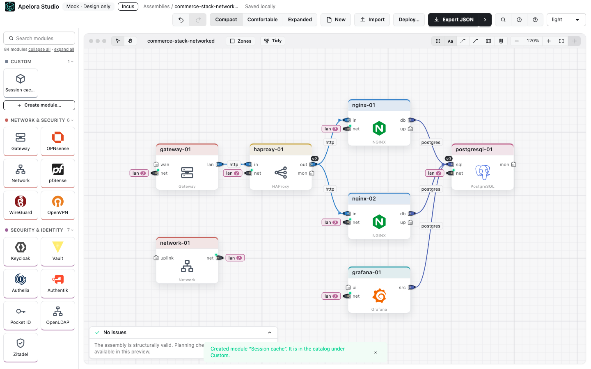
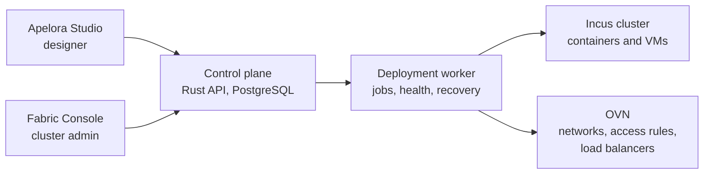

<p align="center">
  
</p>

<h1 align="center">Apelora Fabric</h1>

<p align="center">
  <strong>Draw a distributed application, then run it on your own Linux servers.</strong>
</p>

<p align="center">
  <a href="https://github.com/Apelora/apelora-fabric/actions/workflows/ci.yml"></a>
  <a href="https://github.com/Apelora/apelora-fabric/actions/workflows/github-code-scanning/codeql"></a>
  <a href="https://github.com/Apelora/apelora-fabric/actions/workflows/upstream-check.yml"></a>
  <a href="LICENSE"></a>
  <a href="upstream.lock.yaml"></a>
  <a href="rust-toolchain.toml"></a>
  <a href="docs/architecture/current-state.md"></a>
  <a href="#citing-apelora-fabric"></a>
</p>

<p align="center">
  <a href="#quick-start">Quick start</a> &nbsp;|&nbsp;
  <a href="docs/architecture/current-state.md">What works today</a> &nbsp;|&nbsp;
  <a href="#documentation">Documentation</a> &nbsp;|&nbsp;
  <a href="#citing-apelora-fabric">Cite</a>
</p>

<p align="center">
  
</p>

For teams that run their own servers and would rather connect parts than hand-write container, network and firewall configuration. You connect appliances such as a gateway, NGINX and PostgreSQL in a visual designer. Apelora turns each connection into a private network, an access rule and a service address. It keeps the replicas you asked for running on [Incus](https://linuxcontainers.org/incus/).

> **Status: early development.** Core paths are tested on a disposable four-server Incus cluster. It is not ready for production. See [what works today](docs/architecture/current-state.md) and the [known limitations](docs/architecture/current-state.md#known-limitations).

## How it works

Three steps, from drawing to running application:

1. **Design.** In Apelora Studio, drag appliances onto the canvas and connect their typed ports. The designer refuses connections that cannot work, such as HTTP into a database port.
2. **Deploy.** The control plane checks the design against the cluster. The deployment worker then creates each container or VM in Incus as a durable job, so a crash or a repeated request never creates duplicates.
3. **Operate.** Only the connections you drew are allowed through. Replicas are spread across servers, unhealthy ones are restarted, and lost ones are replaced when a server fails.



Apelora owns the application: its design, desired state, connections, replicas and health. Incus owns the servers: membership, placement and the instances themselves. Apelora talks to Incus only through its documented REST API.

## What is in this repository

| Part | Location | State |
|---|---|---|
| **Apelora Studio**: visual application designer (React, React Flow) | [`apps/studio`](apps/studio) | Working; deploys through the control plane |
| **Fabric Console**: cluster administration (servers, instances, enrolment, audit) | [`apps/fabric-console`](apps/fabric-console) | Working |
| **Control plane**: Rust (Axum) API, plans, deployments, roles, audit | [`services/control-plane`](services/control-plane) | Working; tested on Incus |
| **Deployment worker**: jobs, network enforcement, replica supervision, recovery | [`services/deployment-worker`](services/deployment-worker) | Working; tested on Incus |
| **Incus adapter** and shared Rust domain | [`crates/`](crates) | Working |
| **Catalog and model**: appliance definitions, ports, schema | [`packages/`](packages) | Working |

Results are labelled by how they were checked: **REAL INCUS TESTED** (on the disposable cluster), **CONTRACT VERIFIED** (against recorded Incus responses) or **MOCK VERIFIED** (against the mock provider).

## Quick start

The designer runs in the browser. On its own it uses mock data and deploys nothing.

```sh
npm install
npm run dev          # Studio at http://127.0.0.1:5173
```

To deploy for real, start PostgreSQL, the control plane and a disposable Incus cluster (Lima VMs on your workstation):

```sh
docker compose -f infra/dev/compose.yaml up -d       # PostgreSQL on 127.0.0.1:15432
bash scripts/test-cluster/up.sh                      # disposable Incus cluster
source ~/.config/apelora/test-cluster/env            # its address and client certificate
cargo run -p apelora-control-plane                   # API at http://127.0.0.1:8080
npm run dev:console                                  # Fabric Console at http://127.0.0.1:5174
```

The full walkthrough, including API tokens and adding cluster members, is in [docs/development/TEST-CLUSTER.md](docs/development/TEST-CLUSTER.md).

### Checks

```sh
npm run typecheck && npm run lint && npm test && npm run build
npx playwright install chromium && npm run test:e2e
cargo fmt --check && cargo clippy --workspace --all-targets -- -D warnings && cargo test --workspace
```

## Documentation

| Read this | For |
|---|---|
| [Current state](docs/architecture/current-state.md) | What is verified, how, and the known limitations |
| [Platform architecture](docs/architecture/PLATFORM-ARCHITECTURE.md) | The target design and who owns which state |
| [Decisions](docs/adr/) | Architecture decision records |
| [Implementation phases](docs/development/IMPLEMENTATION-PHASES.md) | The build plan, phase by phase |
| [Runbooks](docs/runbooks/README.md) | Operating procedures: member failure, quorum loss, certificates |
| [Studio design](docs/architecture/STUDIO-MVP.md) | How the designer works; screenshots in [`docs/screenshots/`](docs/screenshots/) |
| [AGENTS.md](AGENTS.md) | Project rules for contributors and coding agents |

## Citing Apelora Fabric

If you use Apelora Fabric in research or a publication, please cite it. GitHub's **Cite this repository** button (in the sidebar) reads [`CITATION.cff`](CITATION.cff) and gives APA and BibTeX. In BibTeX:

```bibtex
@software{suliman_apelora_fabric,
  author  = {Suliman, Tamir},
  title   = {Apelora Fabric: designing and operating distributed applications on Incus},
  url     = {https://github.com/Apelora/apelora-fabric},
  license = {AGPL-3.0-only},
  year    = {2026}
}
```

## Licensing

**Community:** GNU Affero General Public License version 3 only (`AGPL-3.0-only`). See [LICENSE](LICENSE) and the [official license](https://www.gnu.org/licenses/agpl-3.0.html).

**Commercial:** A separate negotiated license may be available from the copyright owners. See [COMMERCIAL-LICENSE.md](COMMERCIAL-LICENSE.md). Commercial use is also permitted under AGPLv3 when its conditions are met; a commercial license is *not* mandatory merely because the user is a business.

**Marks:** Code licensing does not grant a right to use Apelora names or logos to imply official endorsement. See [TRADEMARKS.md](TRADEMARKS.md).

**Important:** Before releasing source code, replace the LICENSE placeholder with the *complete, unmodified* official AGPLv3 text (instructions below). Review upstream licences (Incus is Apache-2.0) and any contributor rights needed to support dual licensing.

### Preparing the license before publication

Run `bash scripts/install-agpl-license.sh`, inspect `LICENSE`, and commit the resulting full text. Do not publish a release until this step is complete.

## Contributing

See [CONTRIBUTING.md](CONTRIBUTING.md). The initial contribution policy limits outside code contributions while commercial licensing rights are being designed.
