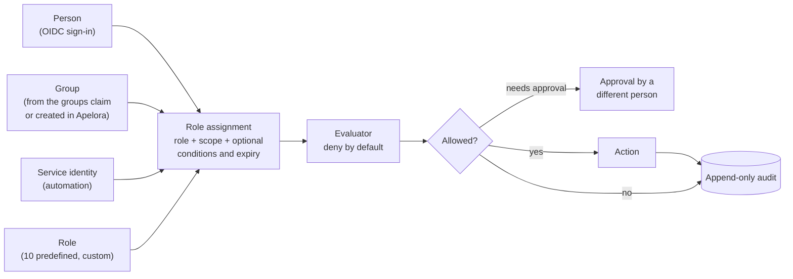
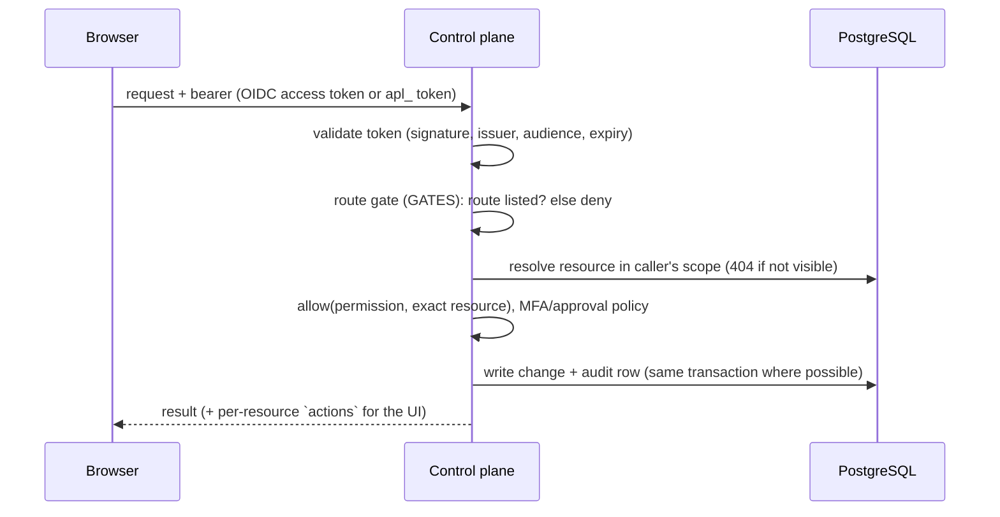

# Identity and authorization

Status: **built and tested against stubs and a mock provider; not yet verified against a live identity provider, MAAS or a real restricted Incus project.** Design rationale: [access and roles](ACCESS-AND-ROLES.md) and [ADR 0005](../adr/0005-access-model.md). Working checklist for contributors: the `identity-authorization` skill.

Evidence labels: **BUILT** (in the repository, covered by tests), **NOT VERIFIED** (written from documentation, exercised only by stubs).

## 1. Model

- **Scopes** nest: platform → organisation → project → application (and pool for infrastructure). An assignment at a scope applies to everything below it.
- **Permission classes**: `Tenant` (applications, projects, members), `Infrastructure` (cluster, networks, storage, hardware) and `Security` (identity, policy, emergency access). Each permission has a **floor**, the narrowest scope it may be granted at; only `Tenant` permissions can be granted below platform level, so a project role can never reach servers, the cluster or the platform's own security settings.
- **Predefined roles** (ten) and **custom roles** are sets of catalogue permissions. Nothing checks a role name.
- **Service identities** hold roles like people but are withheld from security and people-management permissions, and never get interactive sessions.
- **Legacy `apl_` tokens** stay platform-wide and exempt from approvals; set `APELORA_LEGACY_TOKENS=disabled` once people sign in through OIDC.

## 2. Request path

Rules that are enforced and tested (API integration tests, 22 for identity, 13 for application management):

- A route not in `GATES` is refused for people and services.
- Every handler checks the **exact resource**; objects the caller cannot see answer 404.
- The **escalation guard** (`check_assignment`) stops anyone granting more than they hold or at a wider scope; the preview endpoint uses the same checks as create.
- **Approvals**: flagged permissions need a recorded approval by a different person for the exact action and target, single use, 30 minutes (`Apelora-Approval` header). Self-approval is refused.
- **Emergency access**: at most 4 hours, a written reason, cannot be self-granted, every request under it audited.
- **Audit** is append-only (database trigger); reads are scoped to what the caller may see. Denials of sensitive actions are recorded.

## 3. Sign-in

OIDC access tokens are validated by `crates/identity`: asymmetric algorithms only (no `none`, no shared-secret algorithms), issuer and audience pinned, `exp`/`nbf`/`iat` checked with 30 s leeway, maximum lifetime, key set fetched over TLS only (loopback allowed for development) and cached. An application end-user token with another audience is refused. MFA is derived from configured `amr`/`acr` values and can be required by an access policy.

Configuration is environment-only: `APELORA_OIDC_ISSUER`, `APELORA_OIDC_AUDIENCE`, optional `APELORA_OIDC_GROUPS_CLAIM`, `APELORA_OIDC_USERNAME_CLAIM`, `APELORA_OIDC_MFA_AMR`, `APELORA_OIDC_MFA_ACR`, `APELORA_OIDC_AUTHORIZED_PARTIES`. Without an issuer, only API tokens work. A realm setup guide with no secrets is in [infra/identity/keycloak](../../infra/identity/keycloak/README.md) (**NOT VERIFIED** against a running server).

## 4. Backends

Apelora never connects people to Incus. It maps its decisions onto each backend's own controls:

| Backend | Mapping | State |
|---|---|---|
| Incus | One restricted project per environment; Apelora's service certificate is the only client. | NOT VERIFIED for restricted-project enforcement beyond the existing REAL INCUS TESTED deployments |
| MAAS | Entitlements are mapped only for MAAS 3.8+ and only view/deploy. | NOT VERIFIED |

## 5. User interfaces

- **Fabric Console → Identity & Access**: Users, Groups, Organizations (→ projects → environments), Project memberships, Roles & permissions, Service identities, Access policies (+ Approvals), Audit history. The assignment dialog asks the server for a preview and shows effective permissions with their origin before anything is saved; emergency access has its own warning dialog; service tokens appear once in a copy-once dialog and leave the DOM when closed. Pages appear only if `whoami.capabilities` holds a matching permission.
- **Studio → Applications**: every action is enabled from the `actions` the API returns for that caller and application, with the reason when disabled.

## 6. Known gaps

1. `ApplicationInfo` has no `id`, so an application-scoped assignment needs a pasted UUID.
2. `preview_assignment` does not run the principal checks that create runs (disabled user, unknown service identity); the error appears at save time.
3. Assignments, memberships and audit rows carry ids; names are resolved from lists the caller may not be allowed to read, so some show as ids.
4. No endpoint previews a custom role's assignable levels before creating it.
5. Remote desktop (RDP) is **not built**: there is no gateway, so the API reports it as unavailable with that reason. PowerShell into Windows modules is wired through the same exec channel but has never run against a Windows guest (**NOT VERIFIED**).
6. Terminal sessions have only run against a labelled mock shell and an Incus-shaped contract fixture, never a real Incus (see section 7).
6. Real Keycloak, MAAS 3.8 and Incus restricted-project behaviour must be verified before these are called production-ready.

## 7. Interactive access to modules (terminal, PowerShell)

Contract: the `secure-remote-access` skill. Built as one slice; evidence **MOCK VERIFIED** (control plane: 15 API tests, 4 unit tests, with a real websocket against PostgreSQL and the mock Incus; 10 Studio browser tests with a stubbed API and websocket) and **CONTRACT VERIFIED** (Incus exec protocol: 8 tests over real mutual TLS and websocket upgrades). Not run against a real Incus, Windows guests or a live identity provider.

| Rule | How it is enforced |
|---|---|
| Brokered | The browser talks only to the Apelora API; the API opens an Incus exec session through the adapter (`Provider::open_shell`). No Incus address, certificate or secret reaches the browser. |
| Who | Permissions `instance.console` (terminal, PowerShell) and `instance.desktop` (RDP), tenant class, floor application. Held by the predefined **Instance Access** role, project administrators and organisation owners, or a custom role. Application operators do **not** hold them, so a CI identity can still be an operator. |
| Never | Service identities and legacy tokens are refused (`withheld_from_services`, no legacy mapping). |
| Which instance | The route gate lets a holder in; the handler then checks the exact application, that the instance is Apelora's, belongs to that application, is running and observable. Anything the caller cannot see answers 404. |
| Production | Needs another person's approval (`Apelora-Approval`, single use) for `instance.console` on `instance:<application>/<instance>`. Requests and approvals are judged on the application, not the platform: an approver needs `approval.grant` on that application. An environment of unknown kind is treated like production. |
| Ticket | `POST /api/v1/applications/{name}/instances/{instance}/sessions` returns a 256-bit single-use ticket (60 s, SHA-256 kept in memory, bound to the person, instance and browser origin). The websocket (`GET /api/v1/sessions/connect`, outside the bearer layer) takes it from `Sec-WebSocket-Protocol: apelora.session.v1, ticket.<value>`, never from a URL, and checks `Origin` (own host or `APELORA_ALLOWED_ORIGINS`). |
| Runs as | Linux terminals: uid/gid 1000 (`APELORA_CONSOLE_UID`, `APELORA_CONSOLE_GID`), never root unless set to 0 on purpose; `HOME` and working directory `/tmp`. That is not automatically unprivileged: uid 1000 is the first ordinary user in many images and may have passwordless `sudo`. Give modules a user the sessions should become and set the uid to it. PowerShell sends no user at all (numeric ids mean nothing there), so it runs as whatever the guest agent runs as: it is **off by default** (`APELORA_CONSOLE_POWERSHELL=enabled` turns it on) until it has been run against a Windows guest. |
| Limits | Idle 15 min and absolute 60 min (`APELORA_CONSOLE_IDLE_SECS`, `APELORA_CONSOLE_MAX_SECS`), 3 sessions or tickets per person (a session counts from the moment its ticket is spent, not when the shell opens), 10 tickets a minute, 16 KiB messages, 256 KiB/s of input counting every frame. A limit that refuses a request never spends the approval it came with. Every send to the browser or to Incus is bounded (5 s): a peer that stops reading ends the session as `stalled`, so the idle, maximum, revocation and terminate controls keep working, and the slot is released however the task ends. |
| While running | Before the shell opens and every 30 s after, the session re-reads the person's account, their group memberships recorded in Apelora, and their assignments; a revoked role, a removed membership or a disabled account ends it (`access-revoked`). Groups that mirror an identity-provider group keep the value from sign-in: the provider cannot be asked again without a token, which is another reason for a short maximum time. `DELETE /api/v1/sessions/{id}` ends one (the person, or whoever may operate the application). |
| Audit | `session.request`, `session.open`, `session.close` (reason, seconds, byte counts), `session.denied`, `session.terminate`, plus `access.denied` from the gate. Typed or displayed content and the ticket are never stored. |
| Off switch | `APELORA_CONSOLE_ACCESS=disabled`. |
| Who can list and end sessions | A person sees and ends their own. Whoever may operate the application (`application.operate`), including an automation identity, sees and ends everyone's on it; that is deliberate, so a runbook or an alert can cut a session. An automation identity can never open one. |
| Approvals for sessions | Requests are capped at 20 waiting per person, and a target the caller cannot see answers like one that does not exist. |
| Limits of this design | Sessions live in the control plane's memory: they end on restart and are not shared between replicas. Idle time counts typing, not output. RDP needs a gateway that does not exist yet. The right-click entries appear on the Designer canvas of an application whenever the control plane reports running instances of a module with that id; they name the instance, and the control plane checks the instance, not the canvas. Invalid or expired tickets are not audited (they would let an anonymous caller grow the audit table). |

