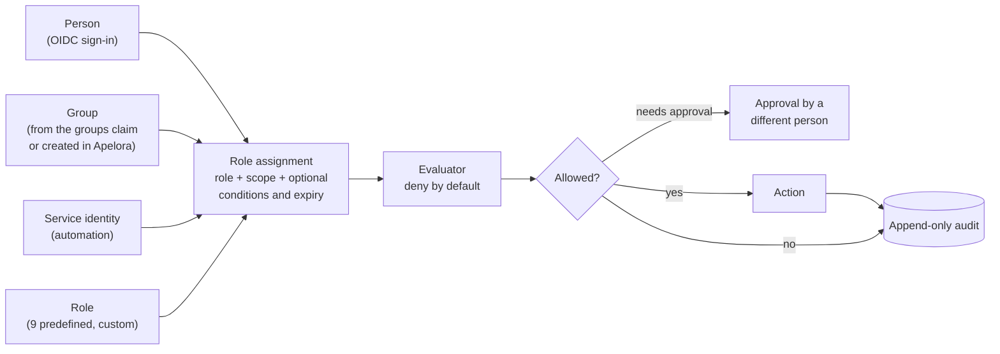
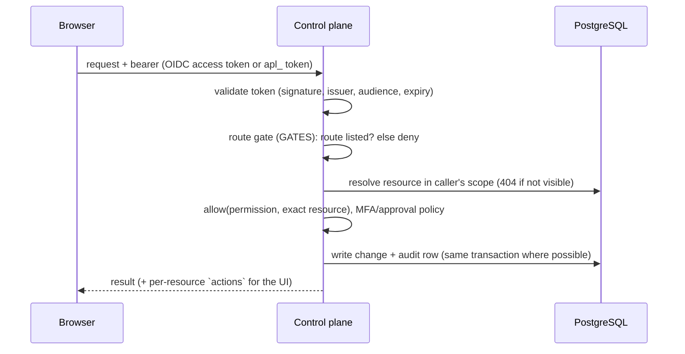

# Identity and authorization

Status: **built and tested against stubs and a mock provider; not yet verified against a live identity provider, MAAS or a real restricted Incus project.** Design rationale: [access and roles](ACCESS-AND-ROLES.md) and [ADR 0005](../adr/0005-access-model.md). Working checklist for contributors: the `identity-authorization` skill.

Evidence labels: **BUILT** (in the repository, covered by tests), **NOT VERIFIED** (written from documentation, exercised only by stubs).

## 1. Model

- **Scopes** nest: platform → organisation → project → application (and pool for infrastructure). An assignment at a scope applies to everything below it.
- **Permission classes**: `Tenant` (applications, projects, members), `Infrastructure` (cluster, networks, storage, hardware) and `Security` (identity, policy, emergency access). Each permission has a **floor**, the narrowest scope it may be granted at; only `Tenant` permissions can be granted below platform level, so a project role can never reach servers, the cluster or the platform's own security settings.
- **Predefined roles** (nine) and **custom roles** are sets of catalogue permissions. Nothing checks a role name.
- **Service identities** hold roles like people but are withheld from security and people-management permissions, and never get interactive sessions.
- **Legacy `apl_` tokens** stay platform-wide and exempt from approvals; set `APELORA_LEGACY_TOKENS=disabled` once people sign in through OIDC.

## 2. Request path

Rules that are enforced and tested (API integration tests, 22 for identity, 13 for application management):

- A route not in `GATES` is refused for people and services.
- Every handler checks the **exact resource**; objects the caller cannot see answer 404.
- The **escalation guard** (`check_assignment`) stops anyone granting more than they hold or at a wider scope; the preview endpoint uses the same checks as create.
- **Approvals**: flagged permissions need a recorded approval by a different person for the exact action and target, single use, 30 minutes (`Apelora-Approval` header). Self-approval is refused.
- **Emergency access**: at most 4 hours, a written reason, cannot be self-granted, every request under it audited.
- **Audit** is append-only (database trigger); reads are scoped to what the caller may see. Denials of sensitive actions are recorded.

## 3. Sign-in

OIDC access tokens are validated by `crates/identity`: asymmetric algorithms only (no `none`, no shared-secret algorithms), issuer and audience pinned, `exp`/`nbf`/`iat` checked with 30 s leeway, maximum lifetime, key set fetched over TLS only (loopback allowed for development) and cached. An application end-user token with another audience is refused. MFA is derived from configured `amr`/`acr` values and can be required by an access policy.

Configuration is environment-only: `APELORA_OIDC_ISSUER`, `APELORA_OIDC_AUDIENCE`, optional `APELORA_OIDC_GROUPS_CLAIM`, `APELORA_OIDC_USERNAME_CLAIM`, `APELORA_OIDC_MFA_AMR`, `APELORA_OIDC_MFA_ACR`, `APELORA_OIDC_AUTHORIZED_PARTIES`. Without an issuer, only API tokens work. A realm setup guide with no secrets is in [infra/identity/keycloak](../../infra/identity/keycloak/README.md) (**NOT VERIFIED** against a running server).

## 4. Backends

Apelora never connects people to Incus. It maps its decisions onto each backend's own controls:

| Backend | Mapping | State |
|---|---|---|
| Incus | One restricted project per environment; Apelora's service certificate is the only client. | NOT VERIFIED for restricted-project enforcement beyond the existing REAL INCUS TESTED deployments |
| MAAS | Entitlements are mapped only for MAAS 3.8+ and only view/deploy. | NOT VERIFIED |

## 5. User interfaces

- **Fabric Console → Identity & Access**: Users, Groups, Organizations (→ projects → environments), Project memberships, Roles & permissions, Service identities, Access policies (+ Approvals), Audit history. The assignment dialog asks the server for a preview and shows effective permissions with their origin before anything is saved; emergency access has its own warning dialog; service tokens appear once in a copy-once dialog and leave the DOM when closed. Pages appear only if `whoami.capabilities` holds a matching permission.
- **Studio → Applications**: every action is enabled from the `actions` the API returns for that caller and application, with the reason when disabled.

## 6. Known gaps

1. `ApplicationInfo` has no `id`, so an application-scoped assignment needs a pasted UUID.
2. `preview_assignment` does not run the principal checks that create runs (disabled user, unknown service identity); the error appears at save time.
3. Assignments, memberships and audit rows carry ids; names are resolved from lists the caller may not be allowed to read, so some show as ids.
4. No endpoint previews a custom role's assignable levels before creating it.
5. Interactive access to instances (terminal, PowerShell, RDP) is **not built**; its contract is the `secure-remote-access` skill.
6. Real Keycloak, MAAS 3.8 and Incus restricted-project behaviour must be verified before these are called production-ready.
