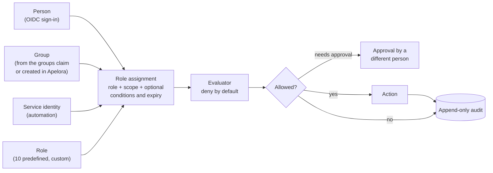
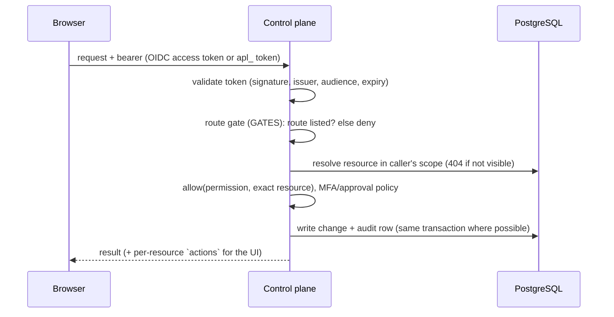

# Identity and authorization

Status: **built and tested against stubs and a mock provider; browser sign-in tested in a real browser against a local development identity provider; not yet verified against an enterprise provider in production, MAAS or a real restricted Incus project.** Design rationale: [access and roles](ACCESS-AND-ROLES.md) and [ADR 0005](../adr/0005-access-model.md). Working checklist for contributors: the `identity-authorization` skill.

Evidence labels: **BUILT** (in the repository, covered by tests), **NOT VERIFIED** (written from documentation, exercised only by stubs).

## 1. Model

- **Scopes** nest: platform → organisation → project → application (and pool for infrastructure). An assignment at a scope applies to everything below it.
- **Permission classes**: `Tenant` (applications, projects, members), `Infrastructure` (cluster, networks, storage, hardware) and `Security` (identity, policy, emergency access). Each permission has a **floor**, the narrowest scope it may be granted at; only `Tenant` permissions can be granted below platform level, so a project role can never reach servers, the cluster or the platform's own security settings.
- **Predefined roles** (ten) and **custom roles** are sets of catalogue permissions. Nothing checks a role name.
- **Service identities** hold roles like people but are withheld from security and people-management permissions, and never get interactive sessions.
- **Legacy `apl_` tokens** stay platform-wide and exempt from approvals and multi-factor rules (they cannot present either); they pass the same route gate as everyone else, through their role's legacy mapping, and cannot create `fabric-admin` tokens. Set `APELORA_LEGACY_TOKENS=disabled` once people sign in through OIDC.

## 2. Request path

Rules that are enforced and tested (API integration tests, 22 for identity, 13 for application management):

- A route not in `GATES` is refused for every caller (people, services, legacy tokens and the development principal).
- Every handler checks the **exact resource**; objects the caller cannot see answer 404.
- The **escalation guard** (`check_assignment`) stops anyone granting more than they hold or at a wider scope; the preview endpoint uses the same checks as create. **Revoking** uses the same test (`check_revocation`): only someone who could grant the role at that scope may revoke it (403 `revocation_refused`, audited); emergency grants can also be ended with `platform.emergency_access`.
- **Tokens never exceed their creator.** An API token's role is refused (403 `token_exceeds_caller`, audited as a denied `token.create`) when it carries any permission the creator does not hold at platform level. A `fabric-admin` token needs another person's approval of `token.create_admin` on `token:fabric-admin`; legacy tokens cannot present one and are refused (`approval_unavailable`). Every token expires: 1–365 days, 90 by default, through the API and the command line (`--expires-in-days`); a service token asking for more is refused with 400, not shortened.
- **The last super admin stays.** Disabling a person, revoking an assignment or removing a group member is refused (409 `last_super_admin`, audited as denied) when it would leave no enabled person holding `platform-super-admin` at platform level, directly or through a group membership recorded in Apelora. The change and the count run in one transaction under an advisory lock, so concurrent changes cannot both pass. Membership through an identity provider's group claim is not counted (it is only known at sign-in). With no super admin at all (a platform run on API tokens), nothing is refused.
- **Approvals**: flagged permissions need a recorded approval by a different person for the exact action and target, single use, 30 minutes (`Apelora-Approval` header). Self-approval is refused.
- **Emergency access**: at most 4 hours, a written reason, cannot be self-granted, every request under it audited.
- **Audit** is append-only (database trigger); reads are scoped to what the caller may see. Denials of sensitive actions are recorded.

## 3. Sign-in

How people and administrators use it, with screenshots and troubleshooting: [Signing in](../guides/signing-in.md).

OIDC access tokens are validated by `crates/identity`: asymmetric algorithms only (no `none`, no shared-secret algorithms), issuer and audience pinned, `exp`/`nbf`/`iat` checked with 30 s leeway, maximum lifetime, key set fetched over TLS only (loopback allowed for development) and cached. An application end-user token with another audience is refused. MFA is derived from configured `amr`/`acr` values and can be required by an access policy.

**Where sign-in is configured.** Platform administrators (`platform.security.manage`) add, edit, turn off and remove identity providers in the Fabric Console (Identity & Access → Sign-in); changes apply at once, without a restart, and are audited (`identity.provider.saved`, `identity.provider.deleted`). Any OpenID Connect provider works. Per provider: name on the button, issuer, audiences, an optional public browser client ID (no secret; the browser uses authorization code with PKCE, `state` and `nonce`), scopes, the groups and username claims, the `amr`/`acr` values that count as multi-factor, and the clients a token must be issued to (`azp`). *Check connection* reads the provider's discovery document and key set before saving. A provider set by environment variables (`APELORA_OIDC_ISSUER`, `APELORA_OIDC_AUDIENCE`, `APELORA_OIDC_CLIENT_ID`, `APELORA_OIDC_SCOPES`, `APELORA_OIDC_LABEL` and the claim variables; see `.env.example`) keeps working and is shown read-only.

**Choosing the provider for a token.** The control plane reads the token's `iss` (unverified) only to pick the configured provider with that issuer, then verifies the token against that provider alone. An issuer nobody configured is refused.

**API tokens** (`apl_`) are created by a person or token that holds everything the token's role can do, expire within a year, and a `fabric-admin` one needs an approval (see section 2). They can be turned off in the Console once people sign in with a provider (`identity.api_tokens.disabled`). `APELORA_LEGACY_TOKENS=disabled` turns them off for good; the Console cannot turn them back on.

**Local accounts** ([ADR 0007](../adr/0007-sign-in-methods.md), [design](../design/sign-in-methods.md); `services/control-plane/src/api/sessions_auth.rs`, `crates/persistence/src/local_accounts.rs`, `user_sessions.rs`, migration `0017_sign_in_methods.sql`). A local account is a `users` row with the issuer `apelora:local` and the lowercase username (`[a-z0-9._-]{2,64}`, also a database CHECK) as subject, plus a `local_credentials` row. Usernames are unique across every issuer. The setting `auth.local_accounts` is off by default (`PUT /api/v1/identity/sign-in/local-accounts`, `platform.security.manage`, audited). An administrator with `user.manage` creates an account (`POST /api/v1/identity/local-accounts`) or resets one (`POST …/{id}/reset`); both return a one-time setup token (`apw_` + 64 hex, 24 hours, stored as SHA-256, `Cache-Control: no-store`) that the Console turns into the link `#/set-password?token=…` (a fragment, so it never reaches a server log). The person sets the password with `POST /api/v1/sign-in/setup`; the link is spent atomically. A reset removes the password and revokes every session; nobody can reset their own account.

- **Hashing.** Argon2id (RustCrypto `argon2`), memory 19 456 KiB, 2 passes, 1 lane, PHC string in `password_hash`, computed on the blocking pool. Policy: 12 to 128 characters, not the username; no composition rules.
- **Sign-in** (`POST /api/v1/sign-in/password`, public). Every refusal answers `401 invalid_credentials` "The username or password is incorrect.", and every path costs one Argon2id verification: unknown, disabled, locked and not-yet-set-up accounts verify against a dummy hash made with the same parameters (`sessions_auth::plan` decides; tests count the dummy verifications). Five failures in a row lock the account for 15 minutes (`locked_until`, database clock); attempts during a lock are not counted; a success resets the count. Each client address (the TCP peer; forwarded headers are not trusted, so a reverse proxy shares one allowance) gets 10 attempts a minute across sign-in, setup and password change (in memory; `429 rate_limited` with `Retry-After`). Passwords longer than 512 bytes are never hashed. With the optional `directory` field the same endpoint binds to that directory as the person (`directories::verify_directory_sign_in`), creates or refreshes them (`upsert_directory_user`) and issues a session with the directory's groups as external groups; a directory not offered for sign-in answers `400 directory_unavailable`. With local accounts off: `400 local_accounts_disabled`.
- **Sessions.** `issue_session(pool, user_id, method, external_groups)` is the one place `apu_` tokens are made (32 random bytes as hex, stored as SHA-256). `resolve_principal` accepts a session that is not revoked, before its absolute expiry (8 hours), used within the last hour, whose person is not disabled, and (for password sessions) while local accounts are on; every use updates `last_used_at`. Groups are the person's Apelora groups plus groups whose external name is in the session's `external_groups`; `mfa` is false, so policies that require multi-factor refuse local accounts. Sessions end on `POST /api/v1/sign-out`, a reset, a password change (all others), disabling the person (in the same transaction) and turning local accounts off. `whoami.localAccount` tells the UI to offer *Change password* (`PUT /api/v1/me/password`, current password checked and counted towards the lock).
- **Audit.** `auth.password.succeeded`, `auth.password.failed` (username, reason `unknown|wrong|locked|disabled`, address), `auth.locked`, `auth.setup.completed`, `auth.password.changed`, `auth.signed_out`, `identity.local_account.created|reset`, `identity.local_accounts.enabled|disabled`; never a password or token. Failures by unknown usernames use the actor `anonymous`. A username typed into the password field could still end up in the audit as an unknown username; that is the price of auditing failed attempts by name, and the per-address limit bounds the volume.

**Nobody is locked out.** The server refuses: turning API tokens off while signed in with one, or while no other way in remains; removing or turning off the last answering provider while API tokens are off and no local account can sign in; turning local accounts off while signed in with one, or while API tokens are off and no provider answers. Local accounts count as a way in when they are on and at least one account has a password and is not disabled. The guards are enforced by the API (`auth_config::lockout_guard`, `set_api_tokens`, `guard_leaving_local_accounts`), not only by the Console.

**Sign-in page.** The Fabric Console shows one button per provider with a browser client ID, a username and password form when local accounts are on (first without a provider, otherwise below the buttons after "or"), then "Use an API token instead" while API tokens are accepted. The access token is kept for the browser tab only (sessionStorage). If the provider signs someone in but Apelora refuses its token, the page says why (for example "the token lives longer than Apelora accepts": tokens may live at most an hour).

**Troubleshooting.** Each refused credential is logged at `warn` as `credential refused` with method, path, credential kind (`identity-provider token`, `Apelora session`, `service token`, `API token`), the token's issuer and the reason; the token itself is never logged. Refusals are not written to the audit log (one row per bad request would let anyone fill it); a disabled account signing in is (`auth.refused`). At startup and after every change the control plane logs each provider as `identity provider accepted for sign-in` or `identity provider not reachable` with the error; unreachable providers are retried every minute.

**Trying it locally.** `docker compose -f infra/dev/compose.yaml --profile oidc up -d` starts a development identity provider (`infra/dev/dex.yaml`; development credentials only). Add it in the Console with issuer `http://127.0.0.1:5556/dex` and audience and client ID `apelora-console`. A realm setup guide with no secrets is in [infra/identity/keycloak](../../infra/identity/keycloak/README.md).

Evidence: provider configuration, lockout guards, discovery and token verification against a local HTTP provider in the API tests (MOCK VERIFIED); the full browser round trip with PKCE against the local development provider in a real browser (sign-in, `whoami` as the new user, refusal of a 24-hour token with its reason) on 2026-10-21. Enterprise providers in production are NOT VERIFIED. Local accounts: every rule above has an API test against PostgreSQL (`sessions_auth_tests.rs`); REAL-BROWSER TESTED on 2026-10-21 against a real control plane and the development PostgreSQL (setup link, wrong then right password, the user menu, sign-out revoking the session on the server). The Argon2id cost was not timed on production hardware.

**Directories (LDAP over TLS)** ([ADR 0007](../adr/0007-sign-in-methods.md)). Saved in the `directories` table (migration 0018) and managed under Identity & Access → Sign-in → Directories (`GET/POST /api/v1/identity/sign-in/directories`, `PUT/DELETE …/{id}`, `POST …/check`; `platform.security.manage`; audited `identity.directory.saved|deleted`; removal needs the name typed). Rules, in `services/control-plane/src/api/ldap.rs` and `directories.rs`:

- `ldaps://` or `ldap://` with StartTLS only; plain LDAP is refused when saving (API and a database check). TLS through rustls (aws-lc-rs) with certificate and host-name verification always on, against the directory's CA (PEM, 1 to 16 certificates) or the system's roots. TLS 1.2 or later.
- Apelora binds **as the person**: the bind name is the template with `{username}` (a DN, or a principal name such as `{username}@example.org`, which then needs a base DN and user filter). No service-account password exists. The person's own bind reads their entry (base search on the bind DN, or the user filter under the base DN; exactly one entry) and groups (an attribute such as `memberOf`, a group search with `{dn}`/`{username}`, or both).
- The username is escaped per RFC 4514 inside DNs and RFC 4515 inside filters; a principal-name username with `@`, `\` or `/` is refused; an empty password is refused before connecting (an empty-password bind is anonymous). Settings are validated: one `{username}` in the template, filters parsed, attribute names `[A-Za-z][A-Za-z0-9-]*` or numeric OIDs, URL only scheme, host and port.
- A whole sign-in has 10 s (connect, TLS, bind, searches); the list's reachability check (a TLS connection, run in parallel on `GET /api/v1/identity/sign-in`) has 5 s.
- Identity: `users.issuer` = the directory URL, `users.subject` = the configured id attribute, else `entryUUID`, else `objectGUID` as hex, else the DN. Directory group names become the session's external groups and map onto Apelora groups by `groups.external_name`.
- Sign-in functions: `verify_directory_sign_in(state, directory_id, username, password)` → `DirectoryIdentity` (audits `auth.directory.failed` with username and reason; `401 invalid_credentials`, `503 directory_unreachable`, `502 directory_entry_unreadable`, `400 directory_unavailable`) and `upsert_directory_user` (refuses a disabled person with `403 account_disabled`; audits `auth.directory.succeeded`). `POST /api/v1/sign-in/password` with `directory` calls both, then issues the session with method `directory` (wired together with local-account sessions). `GET /api/v1/sign-in` lists enabled directories as `{ id, name }`.
- Passwords are never logged, audited, returned or stored; the check's test password is used for one bind.
- Directories do not yet count as a way in for the lockout guards (they cannot sign anyone in until the password endpoint exists).

Evidence: escaping, validation and attribute/group mapping in unit tests; TLS failures (untrusted CA, host-name mismatch, unreachable) and the deadline against local TLS servers in the API tests; sign-in, wrong password, injection attempts, StartTLS, plain LDAP refused, untrusted CA and host-name mismatch **REAL DIRECTORY TESTED** against the development directory (OpenLDAP in `infra/dev`, profile `directory`) on 2026-10-21; the Console's Directories section REAL-BROWSER TESTED against the same directory (add, test sign-in, save, status). Principal-name directories (`objectGUID`, `userPrincipalName`) are written from documentation and NOT VERIFIED.

## 4. Backends

Apelora never connects people to Incus. It maps its decisions onto each backend's own controls:

| Backend | Mapping | State |
|---|---|---|
| Incus | One restricted project per environment; Apelora's service certificate is the only client. | NOT VERIFIED for restricted-project enforcement beyond the existing REAL INCUS TESTED deployments |
| MAAS | Entitlements are mapped only for MAAS 3.8+ and only view/deploy. | NOT VERIFIED |

## 5. User interfaces

- **Fabric Console → Identity & Access**: Users, Groups, Organizations (→ projects → environments), Project memberships, Roles & permissions, Service identities, Access policies (+ Approvals), Audit history. The assignment dialog asks the server for a preview and shows effective permissions with their origin before anything is saved; emergency access has its own warning dialog; service tokens appear once in a copy-once dialog and leave the DOM when closed. Pages appear only if `whoami.capabilities` holds a matching permission.
- **Studio → Applications**: every action is enabled from the `actions` the API returns for that caller and application, with the reason when disabled.

## 6. Known gaps

1. `ApplicationInfo` has no `id`, so an application-scoped assignment needs a pasted UUID.
2. `preview_assignment` does not run the principal checks that create runs (disabled user, unknown service identity); the error appears at save time.
3. Assignments, memberships and audit rows carry ids; names are resolved from lists the caller may not be allowed to read, so some show as ids.
4. No endpoint previews a custom role's assignable levels before creating it.
5. Remote desktop (RDP) is **not built**: there is no gateway, so the API reports it as unavailable with that reason. PowerShell into Windows modules is wired through the same exec channel but has never run against a Windows guest (**NOT VERIFIED**).
6. Terminal sessions have only run against a labelled mock shell and an Incus-shaped contract fixture, never a real Incus (see section 7).
7. Real Keycloak, MAAS 3.8 and Incus restricted-project behaviour must be verified before these are called production-ready.
8. The Console's token dialog cannot send an approval, so a person creates a `fabric-admin` token through the API (with `Apelora-Approval`) or with the command line on the server. The dialog still offers every role and shows the server's refusal (which roles a token may have is not in any response the Console reads).
9. Legacy `apl_` tokens remain exempt from approvals and multi-factor rules for everything except creating `fabric-admin` tokens; turning them off is the only way to apply those rules to everyone.

## 7. Interactive access to modules (terminal, PowerShell)

Contract: the `secure-remote-access` skill. Built as one slice; evidence **MOCK VERIFIED** (control plane: 15 API tests, 4 unit tests, with a real websocket against PostgreSQL and the mock Incus; 10 Studio browser tests with a stubbed API and websocket) and **CONTRACT VERIFIED** (Incus exec protocol: 8 tests over real mutual TLS and websocket upgrades). Not run against a real Incus, Windows guests or a live identity provider.

| Rule | How it is enforced |
|---|---|
| Brokered | The browser talks only to the Apelora API; the API opens an Incus exec session through the adapter (`Provider::open_shell`). No Incus address, certificate or secret reaches the browser. |
| Who | Permissions `instance.console` (terminal, PowerShell) and `instance.desktop` (RDP), tenant class, floor application. Held by the predefined **Instance Access** role, project administrators and organisation owners, or a custom role. Application operators do **not** hold them, so a CI identity can still be an operator. |
| Never | Service identities and legacy tokens are refused (`withheld_from_services`, no legacy mapping). |
| Which instance | The route gate lets a holder in; the handler then checks the exact application, that the instance is Apelora's, belongs to that application, is running and observable. Anything the caller cannot see answers 404. |
| Production | Needs another person's approval (`Apelora-Approval`, single use) for `instance.console` on `instance:<application>/<instance>`. Requests and approvals are judged on the application, not the platform: an approver needs `approval.grant` on that application. An environment of unknown kind is treated like production. |
| Ticket | `POST /api/v1/applications/{name}/instances/{instance}/sessions` returns a 256-bit single-use ticket (60 s, SHA-256 kept in memory, bound to the person, instance and browser origin). The websocket (`GET /api/v1/sessions/connect`, outside the bearer layer) takes it from `Sec-WebSocket-Protocol: apelora.session.v1, ticket.<value>`, never from a URL, and checks `Origin` (own host or `APELORA_ALLOWED_ORIGINS`). |
| Runs as | Linux terminals: uid/gid 1000 (`APELORA_CONSOLE_UID`, `APELORA_CONSOLE_GID`), never root unless set to 0 on purpose; `HOME` and working directory `/tmp`. That is not automatically unprivileged: uid 1000 is the first ordinary user in many images and may have passwordless `sudo`. Give modules a user the sessions should become and set the uid to it. PowerShell sends no user at all (numeric ids mean nothing there), so it runs as whatever the guest agent runs as: it is **off by default** (`APELORA_CONSOLE_POWERSHELL=enabled` turns it on) until it has been run against a Windows guest. |
| Limits | Idle 15 min and absolute 60 min (`APELORA_CONSOLE_IDLE_SECS`, `APELORA_CONSOLE_MAX_SECS`), 3 sessions or tickets per person (a session counts from the moment its ticket is spent, not when the shell opens), 10 tickets a minute, 16 KiB messages, 256 KiB/s of input counting every frame. A limit that refuses a request never spends the approval it came with. Every send to the browser or to Incus is bounded (5 s): a peer that stops reading ends the session as `stalled`, so the idle, maximum, revocation and terminate controls keep working, and the slot is released however the task ends. |
| While running | Before the shell opens and every 30 s after, the session re-reads the person's account, their group memberships recorded in Apelora, and their assignments; a revoked role, a removed membership or a disabled account ends it (`access-revoked`). Groups that mirror an identity-provider group keep the value from sign-in: the provider cannot be asked again without a token, which is another reason for a short maximum time. `DELETE /api/v1/sessions/{id}` ends one (the person, or whoever may operate the application). |
| Audit | `session.request`, `session.open`, `session.close` (reason, seconds, byte counts), `session.denied`, `session.terminate`, plus `access.denied` from the gate. Typed or displayed content and the ticket are never stored. |
| Off switch | `APELORA_CONSOLE_ACCESS=disabled`. |
| Who can list and end sessions | A person sees and ends their own. Whoever may operate the application (`application.operate`), including an automation identity, sees and ends everyone's on it; that is deliberate, so a runbook or an alert can cut a session. An automation identity can never open one. |
| Approvals for sessions | Requests are capped at 20 waiting per person, and a target the caller cannot see answers like one that does not exist. |
| Limits of this design | Sessions live in the control plane's memory: they end on restart and are not shared between replicas. Idle time counts typing, not output. RDP needs a gateway that does not exist yet. The right-click entries appear on the Designer canvas of an application whenever the control plane reports running instances of a module with that id; they name the instance, and the control plane checks the instance, not the canvas. Invalid or expired tickets are not audited (they would let an anonymous caller grow the audit table). |

