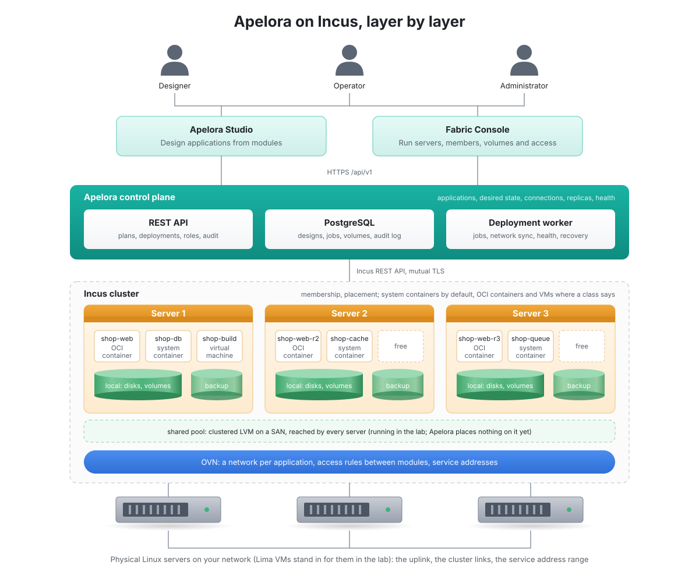
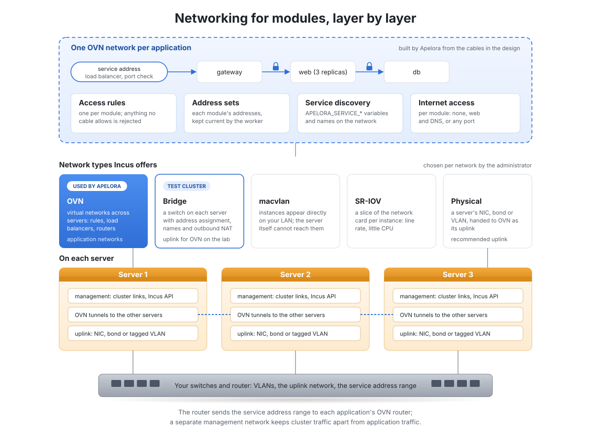
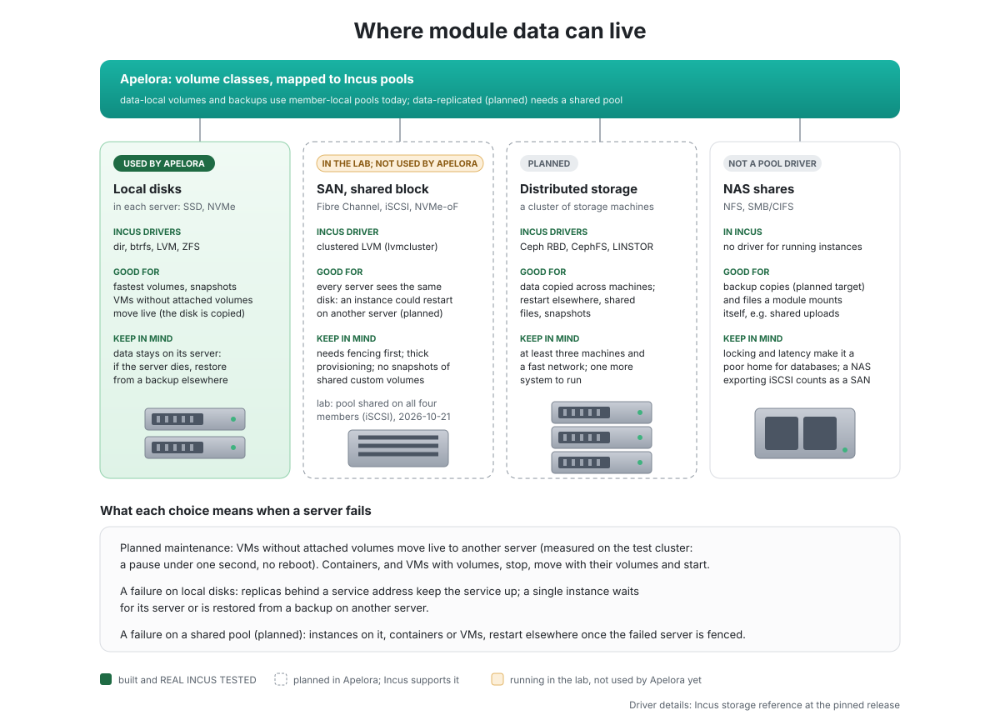

# Apelora platform architecture (target)

Status: **target design** — describes where we are going. Much of it now runs on a disposable test cluster. Date: 2026-10-20. Decisions: [ADR 0001 Incus-first](../adr/0001-incus-first.md) (accepted), [ADR 0002 MAAS](../adr/0002-bare-metal-provisioning-maas.md) (proposed). Plan: [implementation phases](../development/IMPLEMENTATION-PHASES.md). Today's state: [current-state audit](current-state.md).

## 1. Goal

A user composes an application from small modules in **Apelora Studio**, connects typed terminals, chooses resources, replicas and exposure, reviews a deployment plan and deploys it onto a cluster of Linux servers. Administrators run the servers, networks, storage, tenants and failures in **Apelora Fabric Console**. Apelora adds the application layer; it does not re-implement cluster management, packet forwarding or hardware provisioning.

## 2. Three management levels, one authority each

| Level | Authority | Responsibility |
|---|---|---|
| Application | **Apelora** (Rust control plane + PostgreSQL) | Module classes, application graphs, desired state, connectivity intents, service names, publishing, replicas, health, mobility, recovery policy, audit |
| Compute | **Incus** cluster | Membership, quorum (Raft-replicated database), instance placement and lifecycle, projects, profiles, images, storage and network objects, evacuation |
| Network dataplane | Physical LAN/VLAN, later **OVN** (managed through Incus) | Forwarding, logical networks, ACL enforcement, load balancing |
| Bare metal (proposed) | **MAAS** | Discovery, network boot, commissioning, OS install, power control |

Rules: one owner per piece of state; Apelora observes the others and acts only through their APIs; nothing writes another system's database.

## 3. Layers




```text
 LAYER 1  USER INTERFACES (React + TypeScript, independent builds)
 +------------------------------+  +------------------------------+
 | apps/fabric-console          |  | apps/studio                  |
 | servers, members, instances, |  | catalog, React Flow graph,   |
 | networks, storage, tenants,  |  | typed terminals, replicas,   |
 | operations, health, RBAC     |  | exposure, plan, live status  |
 +--------------+---------------+  +---------------+--------------+
                +---------------+------------------+
                                | HTTPS /api/v1 (OpenAPI)
                                v
 LAYER 2  APELORA CONTROL PLANE (Rust)
 +------------------------------------------------------------------+
 | services/control-plane   Axum API, authn/RBAC, catalog, graphs,  |
 |                          validation, plans, operations, audit    |
 | services/deployment-worker  reconciler, jobs, health, recovery   |
 |   libraries: domain, persistence, auth, orchestration,           |
 |   network-fabric, service-discovery, coordination, placement,    |
 |   health, mobility, recovery, storage-policy,                    |
 |   incus-adapter, (maas-adapter, node-enrollment)                 |
 +------------------------+-------------------------+---------------+
                          |                         |
              PostgreSQL (Apelora state)      Incus REST API (mTLS)
                                                    |
 LAYER 3  INCUS CLUSTER  (Raft DB, members, placement, instances)
 +------------------+   +------------------+   +------------------+
 | member 01        |   | member 02        |   | member 03        |
 | Linux + Incus    |   | Linux + Incus    |   | Linux + Incus    |
 | web-01  api-01   |   | web-02  db-01    |   | api-02  worker   |
 +------------------+   +------------------+   +------------------+
          \___________ network: VLAN (MVP) or OVN (full) ________/
 LAYER 4  INFRASTRUCTURE: switches/VLANs, storage (local ZFS; shared
          pool for HA), ingress addresses, DNS, PKI, metrics, backups
```

The network fabric, coordination and HA engines are **libraries inside the two Rust services**, not separate products. "Minion" in the UI means an Incus cluster member; there is no extra Apelora host agent unless an ADR introduces one.

## 4. Modules and runtimes

| Runtime | Default use |
|---|---|
| LXC system container | Web servers, APIs, workers, caches, databases — the default |
| OCI application container | Single-process images, pinned by digest |
| QEMU VM | Other kernels/OSes, firewall-style modules, stronger isolation |
| Composite | A Studio grouping; expands into its members |

A Studio node is a *logical* module; its replicas are separate Incus instances mapped by stable ids. Saved graphs never contain host names or IP addresses.

## 5. Virtual network fabric



**A connection is a service dependency plus an authorisation**, compiled into network intents:

```text
Studio:   web.api ──http──> backend.http
Intent:   source=web target=backend proto=tcp port=8080 access=allow
          discovery=backend.<app>.internal
Apply:    resolve backend replicas → ensure endpoint → apply ACLs →
          configure consumer → check connectivity/readiness
Runtime:  web-01, web-02 ──> backend.<app>.internal:8080 ──> api-01, api-02
```

| Studio element | Becomes |
|---|---|
| Module | Incus instance(s) |
| Input terminal | Service endpoint |
| Output terminal | Dependency |
| Connection | Allowed traffic + name resolution |
| Public terminal | Ingress endpoint |
| Volume connection | Persistent volume attachment |

- **Stable service names** (Apelora-managed) map to healthy replicas, so replacing or moving an instance never breaks consumers.
- **Deterministic compile → diff → apply**, deny by default, scoped by Incus project.
- **Network profiles.** *MVP:* a physical VLAN/L2 that really spans all members (a local bridge does not). *Full platform:* Incus-managed OVN networks — logical networks per application, ACLs, DNS zones, forwards and health-checked load balancers; OVN runs its own services and needs a suitable uplink.

### Publishing applications

| Exposure | Reachable by | Use |
|---|---|---|
| Internal service name | Connected modules | Front end → API |
| Private address | Authorised internal networks | API, databases, caches |
| Shared public HTTPS (default) | Internet, via domain + TLS on shared ingress | Most web apps |
| Dedicated public address | Internet, own address | Special TCP services |
| Private VPN endpoint | VPN users | Internal business apps |

Ingress is a layer-7 proxy for domains and TLS in front of health-checked backends (OVN load balancers or the proxy's own checks). Several replicas behind a single unreplicated ingress is **not** HA.

**Address authority:** provisioning/host addresses — MAAS or site IPAM; container addresses — Incus/OVN; service endpoints — Apelora ingress controller; public addresses — router/provider pool; DNS names — Apelora's DNS integration. Apelora displays all of them and allocates none it does not own.

## 6. Coordination

| Responsibility | Owner | Mechanism |
|---|---|---|
| Cluster membership, leader, instance state | Incus | Its Raft-replicated database |
| Network forwarding state | OVN | Its own databases |
| Deployments, replicas, operations, leases | Apelora | PostgreSQL |
| Health and readiness decisions | Apelora | Health controller |
| Storage ownership | Storage system + policy | Backend + fencing |

- API instances are stateless; the operation queue, leases and generations live in PostgreSQL. Workers claim work with row locks (`FOR UPDATE SKIP LOCKED`) or expiring leases; one reconciliation flow per application at a time; a generation number stops a stale worker from committing old decisions; a recovering worker reads actual Incus state before retrying.
- Locks alone do not prevent split-brain against external APIs: also idempotency keys, Incus operation ids, ownership checks, fencing.
- Control-plane HA needs a redundant entrypoint **and** a tested PostgreSQL failover plan. MVP: one primary with tested backups. No separate consensus service until a measured need.
- MAAS and the control plane run on management infrastructure that survives the loss of the compute cluster.

## 7. Health, HA and mobility

Separate detectors, each with source, timestamp and freshness: member (Incus heartbeat/quorum), instance (Incus state), service (readiness/liveness probes), ingress, storage. **Running ≠ ready ≠ available ≠ recoverable.**

| Workload | Default replicas | Recovery |
|---|---|---|
| Stateless HTTP / API | 2+ on different eligible members | Health-gated routing; replace failed replicas |
| Worker | By queue semantics | Restart/replace; idempotent jobs |
| Cache | 1 unless replicated by design | Recreate |
| Database (single writer) | 1 | **Blocked** on ambiguous failure until fencing + storage ownership proven; operator decides |
| Replicated database | By design | Application-specific failover adapter |
| VM | 1 | Incus migration where supported |

**Relocating stateless modules (replace, then retire):** plan (policy + capacity) → start replacement on another member → wait for readiness → switch the service name's routing → drain and retire the old instance. No container live migration is needed; downtime depends on replica count, draining, sessions and ingress, and is measured, not promised.

**Stateful single instances:** planned stop-and-move with storage checks and an announced interruption. Ordinary LXC live migration is limited and is never assumed.

**Policy-aware evacuation (Mobility & HA engine):** discover workloads on a member → classify (stateless, replicated, singleton, stateful) → check capacity, anti-affinity and minimum-healthy rules → dry-run plan with a reason for every blocked item → stop new placements → drain → relocate one by one with verification → maintenance only when all checks pass → controlled restore (Incus can restore a member without moving instances back). It refuses to remove the last healthy instance of a service whose policy requires continuous service.

**Two recovery modes, mutually exclusive per workload:** native Incus healing (Apelora observes) **or** Apelora-managed recovery (Apelora coordinates fencing and replacement). Never both. Incus healing (`cluster.healing_threshold`) stays at its default (disabled) unless an operator enables it deliberately.

**Placement:** Incus places instances (by default favouring members with fewer instances). Apelora adds replica anti-affinity and failure domains through Incus cluster groups, targets and placement scriptlets once verified — never a competing scheduler.

Milestones: **M1** intelligent evacuation (plan, dry run, drain, move, verify, restore); **M2** replica-aware recovery; **M3** advanced HA (tested fencing, stateful recovery, shared storage, automatic policies).

## 8. Storage



Details — how Incus models pools and volumes, local versus shared storage, the volume-class abstraction and its lifecycle — are in [storage](STORAGE.md).

- Development: local ZFS (or another local Incus pool); snapshots and backups; no cross-member stateful recovery promises.
- HA: a shared/replicated pool supported by Incus (e.g. Ceph RBD, LINSTOR) as an explicitly operated system with its own monitoring. These are external systems that Incus talks to; Apelora does not link or vendor them (Ceph is mainly LGPL), so their licences do not affect our code.
- Volume classes: ephemeral root, persistent exclusive, shared read-only, backup, secret — each with ownership, relocation policy and RPO/RTO. Snapshots are not backups; restores are tested.

## 9. Bare metal (proposed, ADR 0002)

New server → network boot → MAAS commissioning (CPU, RAM, disks, NICs, BMC) → "new server found" in Fabric → **administrator approval** → OS install + cloud-init → preflight → single-use Incus join token → validation → eligible for placement. Power on/off/reboot through MAAS; powering off a member with workloads first proposes an evacuation; emergency power-off is separately permissioned. Networks: provisioning, management, storage and BMC separated (VLANs or equivalent); MAAS DHCP never on a network that already has one without coordination.

## 10. Security and tenancy

Details — roles, scopes, the request path and best practice for every layer — are in [access and roles](ACCESS-AND-ROLES.md) and [ADR 0005](../adr/0005-access-model.md) (proposed).

- Roles: Fabric admin, operator, Studio designer, auditor; every endpoint authorised server-side and scoped by project. Designers cannot change physical infrastructure.
- Incus over mTLS with server verification on a management network; client certificates and BMC credentials only in the backend's secret store — never in the browser, logs or repository.
- Restricted Incus projects, unprivileged containers, no nesting/raw config/host mounts/devices for tenants; image provenance by digest.
- Destructive or risky actions (delete, member removal, storage/network changes, enabling healing, power-off) need confirmation and are audited.

## 10a. Applications as a first-class object

The Studio opens on an **Applications** view (list, create, open a canvas) backed by server-side drafts; see [applications view](../design/applications-view.md).

## 11. Upstream

Incus and (if adopted) MAAS are installed as system packages and tracked in `upstream.lock.yaml`: URL, licence, intended release, verified version/commit, required API extensions, tested host compatibility, verification date. Update checks open reviewable pull requests; nothing upgrades production automatically. An optional read-only source checkout (git-ignored) is for reading only and is never compiled into Apelora.

Contributing back to Incus follows its own rules: contributions must be Apache-2.0 compatible (none of our AGPL code), carry a human author's DCO sign-off and must not credit AI tools; Incus also asks that AI tooling not run on machines holding its repository credentials.

## 12. Non-goals (for now)

A container orchestrator; writing a hypervisor, cluster manager, scheduler, storage engine or distributed filesystem; container live-migration claims; automatic split-brain-prone stateful failover; arbitrary privileged host commands from users; unattended upstream upgrades; a separate consensus service.

## 13. Repository layout (target)

```text
apps/            studio (exists), fabric-console (placeholder)
packages/        assembly-model, module-catalog (exist); api-client, ui (when needed)
services/        control-plane, deployment-worker (skeletons)
crates/          domain, incus-adapter (skeletons); others created by the phase that needs them
infra/           incus/, ovn/, ingress/, storage/, maas/  (runbooks and example configs; later)
scripts/upstream/  update checks (Phase 02)
docs/            adr/, architecture/, development/
.agents/skills/  shared agent skills (Claude via .claude/skills symlinks, Codex natively)
```
