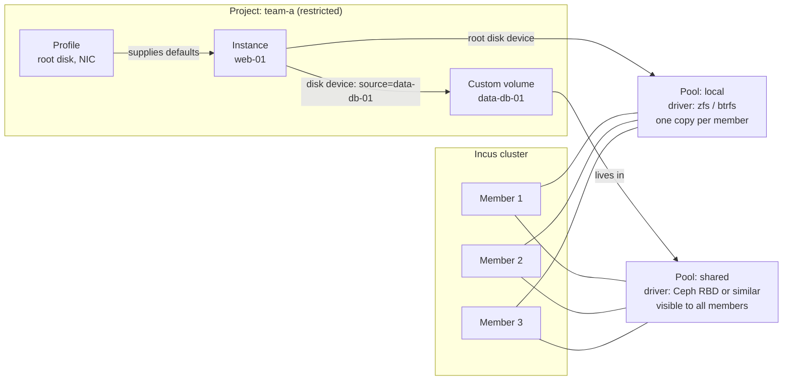
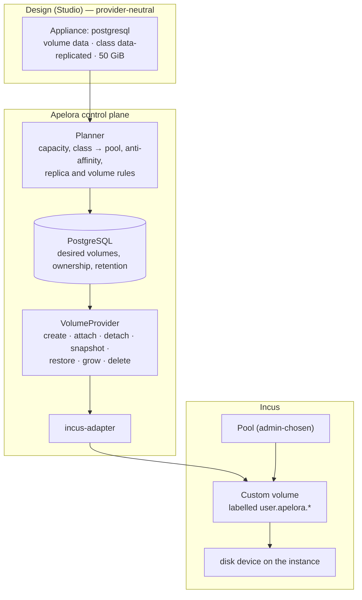
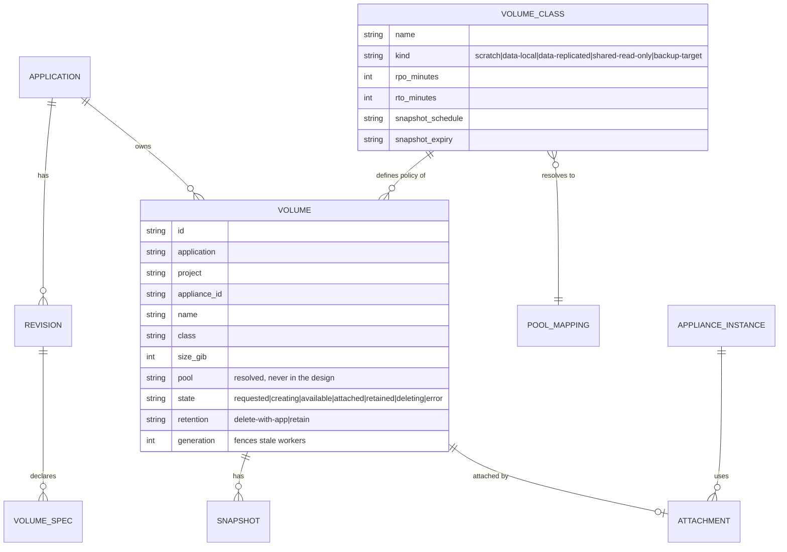
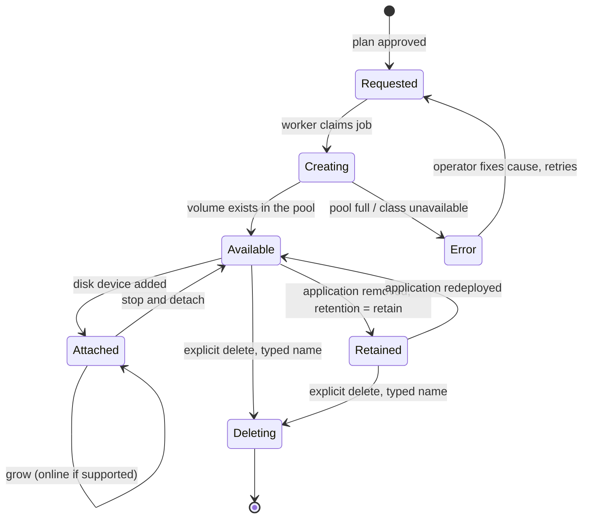
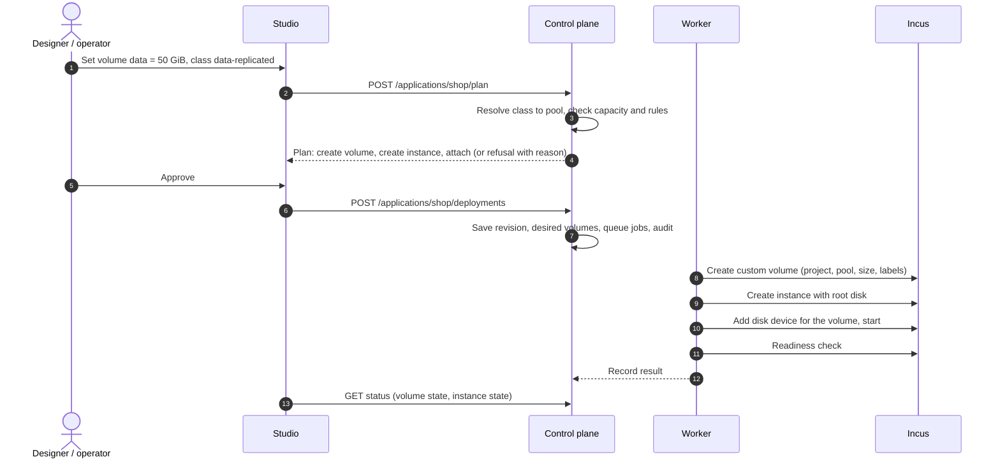

# Storage: how Incus does it, and how Apelora abstracts it

Status: **target design.** What exists: a read-only list of storage pools (`GET /api/v1/storage-pools`, shown in the Fabric Console) and appliances whose root disk comes from the project's default profile on the test cluster's btrfs pool. Persistent volumes, snapshots, backups and storage policy are **not built** (Phase 06 remainder, Phase 08 M3). Every statement about Incus below comes from its documentation and is **NOT YET VERIFIED** on the pinned release (7.0.1); each build step must verify it on the disposable test cluster and record the result. Date: 2026-10-20. Related: [platform architecture](PLATFORM-ARCHITECTURE.md) §8, [ADR 0001](../adr/0001-incus-first.md), skills `storage-recovery` and `storage-volumes`.

## 1. How Incus models storage

| Object | What it is |
|---|---|
| **Storage pool** | A place where Incus keeps data, backed by a *driver* (for example directory, btrfs, LVM, ZFS, Ceph RBD, CephFS). Created and operated by an administrator. |
| **Volume** | A unit of data inside a pool. Kinds: instance volumes (a container's or VM's root), **image** volumes (cached images), **custom** volumes (data you create and attach). A custom volume has a content type: *filesystem* or *block*. |
| **Disk device** | How an instance uses storage: its **root disk** (`pool`, path `/`, optional `size` quota) and any attached custom volume (`source`, `pool`, `path`). Usually inherited from a **profile**. |
| **Snapshot / backup** | Snapshots live in the same pool as their volume. Backups are exported archives that can be stored elsewhere. |
| **Project** | Scopes instances, images, profiles and (by project features) custom volumes, and can **restrict** which devices and pools a tenant may use and how much it may consume. |
| **Bucket** | S3-style object storage offered by some drivers; not used by Apelora yet. |

### 1.1 Local pools and shared pools (the part that decides HA)

| | Local pool (directory, btrfs, LVM, ZFS) | Shared pool (Ceph RBD, CephFS, other remote drivers) |
|---|---|---|
| Where data is | On **one member's** disks. In a cluster the pool exists on every member under the same name, each with its own storage. | In a storage system **outside** Incus that every member reaches over the network |
| Move an instance to another member | Data must be **copied**: planned stop, copy, start | The instance can start elsewhere **without copying data**; live migration depends on instance type and is never assumed |
| Member fails | Data is **unavailable** until the member returns (or a backup is restored) | Data remains reachable; another member may start the instance **after** fencing proves the old one cannot write |
| Cost / complexity | Low, fast, simple | A separate system to deploy, monitor and upgrade |

Rule from the architecture: *a local pool across several members is not shared data.* Apelora must say so in plans instead of implying failover that cannot happen.

## 2. Where Apelora fits: one authority per piece of state

| Concern | Authority |
|---|---|
| Pools, drivers, disks, replication, Ceph health | **Administrators and Incus** (Apelora reads and reports, never configures a driver) |
| Volumes of an application: what exists, how big, which class, who owns it, retention | **Apelora** (desired state in PostgreSQL) |
| Creating, attaching, snapshotting, resizing, deleting volumes | **Incus**, driven by Apelora's worker through the adapter |
| Which member runs a stateful instance | **Incus** places; **Apelora** constrains it (a local volume pins the instance to its member) |

Apelora never writes Incus's database and never invents its own volume store or cluster filesystem.

## 3. The abstraction: designers pick a class, not a pool

A design must not contain pool names, driver names, hosts or addresses (same rule as hosts: [architecture](PLATFORM-ARCHITECTURE.md) §4). Instead:

- An **appliance class** declares the volumes it can use: name, mount path, default size, whether required, and a suggested class. (A database class asks for `data`; a web server asks for none.)
- A **volume class** is an Apelora policy an administrator defines and maps to a pool. The designer chooses a class and a size.
- Administrators map each class to a pool in the Console. If no pool can satisfy a class, the plan says so and refuses; it never silently falls back to a weaker pool.

| Volume class | Meaning | Typical backing | Relocation | Deleted with the application? |
|---|---|---|---|---|
| `scratch` | Disposable working space | Local pool, instance root | Recreated | Yes |
| `data-local` | Persistent, one writer | Local pool | Planned stop, copy, start | **No** (retained) |
| `data-replicated` | Persistent, one writer, survives a member loss | Shared pool | Restart elsewhere after fencing (M3) | **No** (retained) |
| `shared-read-only` | Many readers (assets, models) | Filesystem on a shared pool | Not applicable | No |
| `backup-target` | Receives backups | Separate pool or external target | Not applicable | No |
| `secret` | Not a volume: a reference resolved from the secret store at start | Secret store | Not applicable | Not applicable |

### 3.1 Rules (carried from the `storage-volumes` skill, restated for this design)

1. Removing an appliance from the canvas **never** deletes data. Deleting a volume is an explicit, typed-name confirmed action; retained volumes show as *orphaned* until an owner decides.
2. A read-write **block** volume attaches to at most one instance. A design that gives several replicas the same exclusive volume is invalid (validation error with a hint: use one volume per replica or a shared filesystem class).
3. Resize is **grow-only** by default; shrinking is not offered.
4. Snapshots are taken stopped or with an application-aware hook unless the backend guarantees consistency; Apelora records which one was achieved. **Snapshots are not backups.**
5. All operations are idempotent and level-triggered like every other desired state: re-read Incus, then act.
6. Encrypt at rest where the backend supports it; keys are referenced, never stored in designs or the database.
7. Ownership labels `user.apelora.application`, `user.apelora.appliance`, `user.apelora.volume` are written only by Apelora; anything without them is never touched.

## 4. Data model (PROPOSED)

## 5. Lifecycle

### 5.1 Deploying an appliance with a volume

## 6. Interaction with mobility and recovery

| Workload | Volume | Evacuation / failure behaviour |
|---|---|---|
| Stateless replicas | none (or `scratch`) | Replace then retire; no data to move |
| Stateful single instance | `data-local` | **Blocked** for automatic recovery. Planned maintenance offers *stop, copy, start* with the size and an estimated interruption; member failure waits for the member or a restore |
| Stateful single instance | `data-replicated` | Candidate for restart elsewhere **only after** fencing and ownership are proven (M3). Until then the operator decides |
| Replicated database | One volume per replica | Application-specific failover adapter; Apelora does not guess |

The evacuation dry run lists every volume that blocks a move and why. It never reports "no downtime" for stateful workloads.

## 7. Security

- Volumes are created in the **application's project**, with project limits on disk and volume counts; tenants cannot reach other projects' volumes.
- Restricted projects allow only managed (Apelora-created) disk devices: no host path mounts, no raw device passthrough for tenants.
- Pool configuration and driver credentials (for example Ceph keys) are administrator-only and live in the backend's secret store, never in the browser, designs, logs or the repository.
- Storage actions require their own permission (`manage-storage`, see [roles](ACCESS-AND-ROLES.md)) and are audited.
- Backup copies are independent of the pool they protect.

## 8. Failure handling

| Failure | Behaviour |
|---|---|
| Pool full or class unavailable | Plan refuses with the reason; nothing is changed |
| Create succeeds but attach fails | Volume stays `available`; the job retries; the application is reported as not ready |
| Worker crashes between steps | Next worker re-reads Incus (labels, devices) and continues; generation number stops a stale worker |
| Member with a `data-local` volume fails | Application reported unavailable; no automatic recovery; runbook offers restore from backup |
| Shared storage unreachable | Instances may stall; health shows storage as a separate detector; no automatic restart that could create two writers |
| Someone resizes or deletes a volume in Incus directly | Detected as drift on the next reconcile; reported, not silently "fixed" for destructive differences |

## 9. UI

- **Studio:** a *Volumes* section in the appliance properties (add volume, class, size, mount path); a small disk badge on the node; validation messages for rule 2 and unavailable classes; the deploy review lists volumes to create, keep, grow or leave retained.
- **Fabric Console, Storage:** pools (exists), volume classes and their pool mapping (admin), volumes per project with state, attachment, size and used space, snapshots, orphans; destructive actions need the typed name.

## 10. Build order

**Step 1 progress (REAL INCUS TESTED, 2026-10-20, Incus 7.0.1, btrfs pool `local` on four members, through the restricted deploy identity):**

| Check | Result |
|---|---|
| Create a filesystem custom volume in the restricted project | Works (`features.storage.volumes=true`); it lands on the member that received the request unless `target` is given; the restricted identity **may** target volumes (it may not target instances) |
| Size quota | Enforced: a 1 GiB volume stopped a write at 1.0 GiB (`df` inside shows the pool, not the quota) |
| Attach at creation | Works when the instance runs on the volume's member |
| Placement and a member-local volume | **Incus does not follow the volume**: an instance referencing a volume on another member failed (`Storage volume not found`). Working order: create the instance stopped (Incus places it), create the volume on that member, add the disk device, start — verified |
| Host-path disk in the restricted project | Refused (`Attaching disks not backed by a pool is forbidden`) |
| Grow while attached and running | Works (512 MiB → 1 GiB) |
| Shrink | **Accepted by Incus** (1 GiB → 256 MiB): Apelora must enforce grow-only itself |
| Snapshot | **Refused** in the restricted project (`doesn't allow for snapshot creation`): needs `restricted.snapshots=allow` set by an administrator |
| Restore | Refused while the instance runs (`Cannot restore custom volume used by running instances`); restore after stop not yet verified (no snapshot could be taken) |
| `used_by` | Lists the instances the volume is attached to |

Still to verify: snapshot and restore with snapshots allowed, attach to a VM, a volume outliving its deleted instance, delete, and evacuation of an instance with a member-local volume.

1. Verify on the test cluster, labelled REAL INCUS TESTED: custom volume create, attach to a container and to a VM, snapshot, restore, grow, delete, and the project restrictions in §7; write down what the pinned release actually does.
2. `VolumeProvider` trait, fake provider with fault injection, adapter implementation, `volumes` table and migration.
3. Appliance class `volumes` field and Studio properties section; planner rules; deploy review.
4. Console Storage: classes, volumes, orphans.
5. Snapshots and scheduled backups with a restore drill; then relocation of `data-local` volumes (stop, copy, start).
6. Only with a verified shared pool and tested fencing: `data-replicated` recovery (M3).
