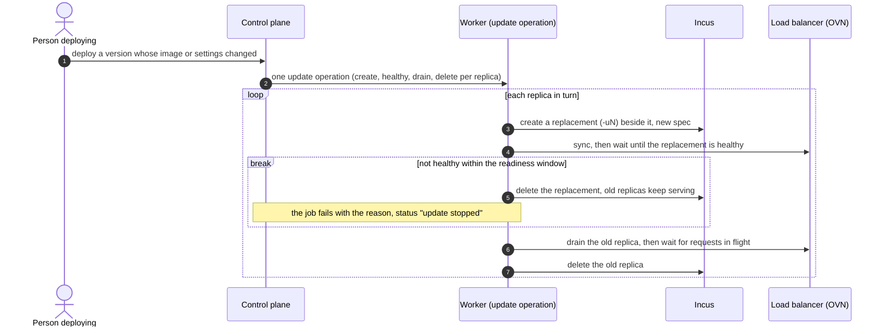

# Updating running modules (rolling replacement and rollback)

Status: slices 1 (2026-10-25) and 2 (2026-10-28) built; slice 3 to do · Date: 2026-10-28 · Related: [application deployment](application-deployment.md) (lists "replacing an instance whose image changed, rollback" as out of scope), [ADR 0015](../adr/0015-application-lifecycle-verbs.md), [application readiness](application-readiness.md)

## 1. Problem and scope

A deployment plan knows five actions: create, keep, resize, remove, conflict (`crates/domain/src/plan.rs`). When a new version of a design changes a module's **image** or its **settings** (`environment.*`, deploy-time fields, live migration), every running replica is **kept**: the plan says "already deployed" and nothing changes. Deploying an earlier version from the Versions tab (a rollback) has the same result. The person deploying is not told.

**Goals**

1. A plan says, per instance, when what runs differs from what the design asks for (image, settings), and what deploying will do about it.
2. Deploying replaces changed instances: stateless replicas one at a time, each new one healthy before the next goes, so the service address keeps answering.
3. Deploying an earlier version is a real rollback, through the same path.
4. A replacement that fails stops the rollout, keeps the replicas that still run the previous version, and says so.

**Non-goals (first slices):** replacing modules with data in place (volumes are kept and re-attached only in slice 3), canary percentages, traffic shifting by weight, scheduled maintenance windows.

**Assumptions:** replicas of a stateless module are interchangeable behind its service address (true today: OVN load balancer with health checks, ADR 0004); a single-replica module has an outage while it is replaced, and the plan must say so and ask, as Stop and Restart already do (ADR 0015).

## 2. Design

**What an instance was built from.** At creation the adapter writes `user.apelora.spec` (`apelora_domain::plan::spec_fingerprint`): a short SHA-256 per part, `image=…,settings=…,storage=…`, so the plan can say *which* part differs. `image`: kind, image source (protocol, server, alias, fingerprint) and architectures. `settings`: instance config and profiles. `storage`: the root disk pool and each volume's name, class, content and path. Left out: resource limits (resized in place), Apelora's discovery keys (`environment.APELORA_*`, re-synced by `network.sync`) and labels, volume sizes (grown in place) and pools (resolved from the class). The fingerprint is taken from the spec as designed, before an image mirror rewrites the source, so a mirror does not make everything look outdated. Callers cannot set it (`user.apelora.*` is reserved).

**Planning.** `plan()` reads the label (exposed on `Instance` like `limits`) and compares it with the hash of the desired spec:

| Observed | Action |
|---|---|
| no label (created before this change) | `keep`, with the reason "built before Apelora recorded its settings; redeploy to replace" |
| label equal | `keep` / `resize` as today |
| label differs, stateless module | `replace`, with `outdated` naming what differs (image, settings, storage) |
| label differs, singleton or stateful | `keep`/`resize` with `outdated` and a warning (slice 3) |

A substitute (`-s<n>`) is kept as it is: it is temporary, and one of its slot's two instances is retired when the failed member returns.

**Applying (stateless, slice 2, built).** A deployment whose plan replaces anything creates one application operation of kind `update` (not a job per instance), so it is one at a time per application (the operations' unique index), resumes after a worker restart from the phases it recorded, and shows in the application's operations like Start or Migrate. For each replaced replica, in plan order, it has four phases: `create` (an ordinary `instance.create` of the update, named `<replica>-u<n>`, the smallest free `n`), `healthy` (the update runs and its service's load balancer has reported it online for `APELORA_UPDATE_HEALTHY_SECS`, default 20; a module without a service address is checked only for running), `drain` (the old replica leaves its service address, with the same `instance_drains` record an evacuation uses, then keeps running `APELORA_UPDATE_DRAIN_SECS`, default 5) and `delete` (an `instance.delete` of the old one). The slot recognises `-u<n>` as it recognises a substitute, so no instance is renamed. An update not healthy within `APELORA_UPDATE_TIMEOUT_SECS` (default 300) of its creation stops the operation: the update is deleted, later phases are skipped, the replicas not yet replaced keep serving, and the operation's error says so ("update stopped: …"). While an update runs, the application's status is `updating`, another deployment of it is refused (`operation_in_progress`), and the supervisor leaves its replica slots and health restarts alone. An update is never asked for through `POST …/operations` (400): only by deploying.

The slice 2 flow:

**Single replica or stateful (slice 3).** Stop, recreate with the same volumes attached, start; needs `confirmDisruption`, like Stop.

## 3. Slices

1. **Visible** (built 2026-10-25): record `user.apelora.spec` at creation; the plan keeps the instance (`keep` or `resize`) and lists the differing parts in `outdated`, with the reason and a warning that deploying does not update running modules yet. A `replace` action is deliberately not added before slice 2: an action that deploying does not carry out would be counted as a change and mislead. The Studio's review marks such rows *Keep · outdated*. Tests: planner unit tests for each row of the table above and for what must not count (limits, discovery keys, volume size); the lab test through the screens publishes a version with another NGINX channel and sees both running replicas marked outdated.
2. **Stateless rolling replacement** with health gating and stop-on-failure (built 2026-10-28). Tests: planner rows (`replace`, an update filling its slot), the worker's update to the end and an update stopped by a replica that never passes (`services/deployment-worker/src/rollout.rs`), the API (`deploying_changed_settings_replaces_stateless_replicas_through_one_update`), the Studio's review and progress (`studio-deploy.spec.ts`). REAL INCUS TESTED (2026-10-28, four members, Incus 7.0.2, `demo.sh`): a setting of the two NGINX web replicas changed; both were planned `replace` under one update, replaced in 151 s, the new ones (`-u1`, `-r2-u1`) run the new setting, 0 of 6,864 requests to the service address failed meanwhile, and deploying the same design again replaced nothing. The stop-on-failure path is MOCK VERIFIED only.
3. **Single replica and stateful** replacement with confirmation.

## 4. Failure handling

| Failure | Behaviour |
|---|---|
| New replica never healthy | delete it, keep the old ones, job fails with the reason |
| Worker dies mid-replacement | the coordinator's lease expires; the next worker resumes from the phase recorded in the operation |
| Member of the new replica fails | it is not healthy in time: the update stops; once it ends, the supervisor's substitute logic applies again |
| Two deployments race | the second is refused while the application's update is active (`operation_in_progress`) |
| Old replica cannot leave its address (sync refused) | the update stops, the old replica serves again; both run until the supervisor retires one of the slot's two instances |
| Cancelled between phases | later phases are skipped; a slot left with two instances is resolved by the supervisor once the update has ended |
| Incus project limit reached | the update's `create` fails: the update stops with Incus's reason (one extra replica exists at a time) |
