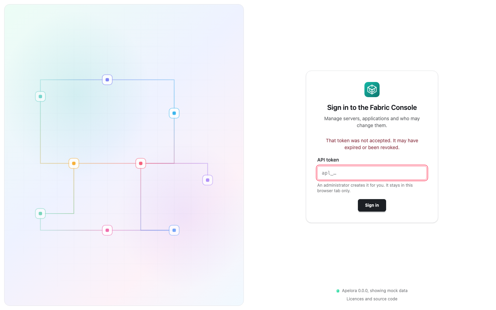
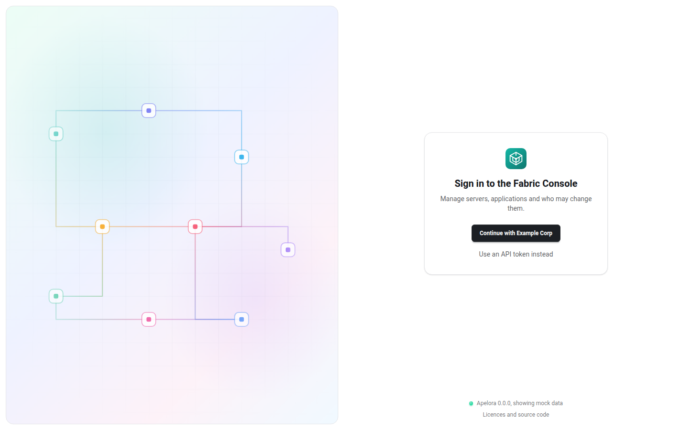
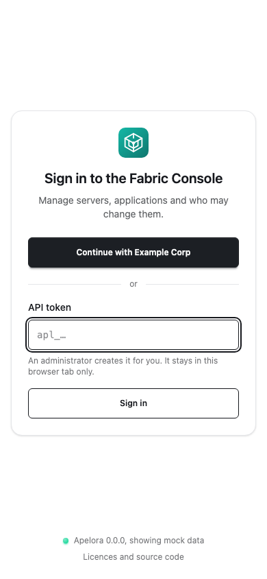
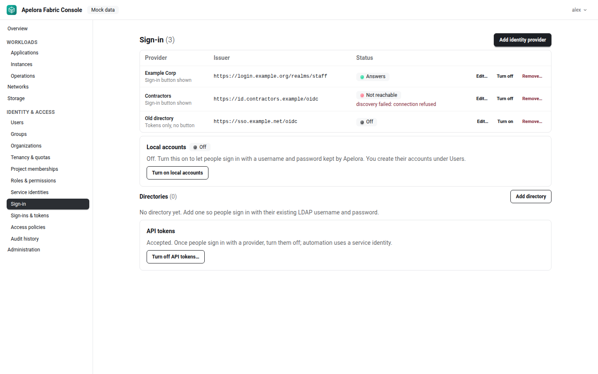
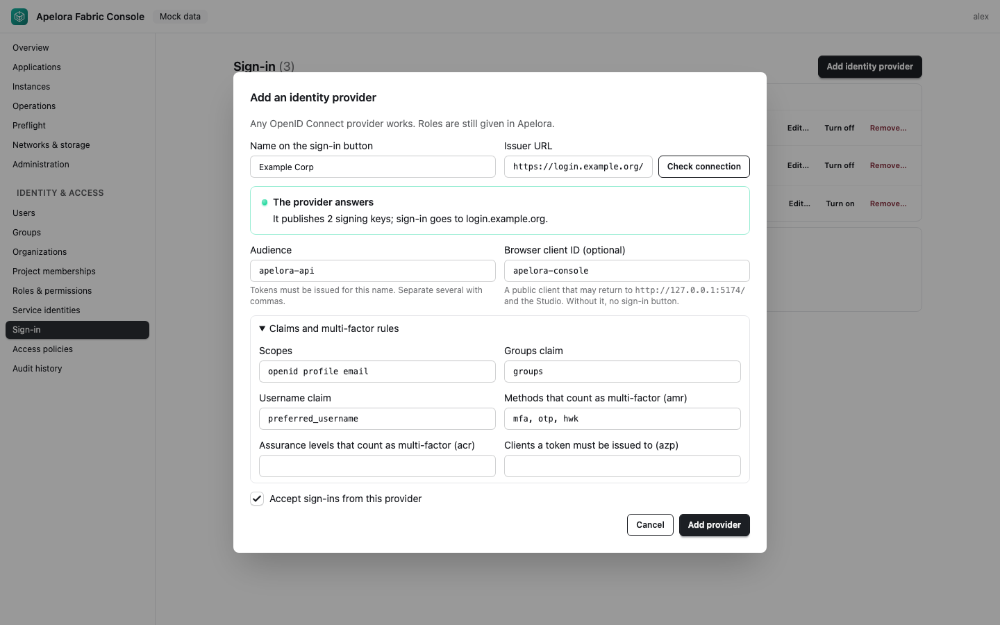

# Signing in to the Fabric Console and the Studio

How people sign in to Apelora, how an administrator sets up sign-in with the organisation's identity provider, and what the messages on the sign-in page mean. Design and security details are in [Identity and authorization, section 3](../architecture/IDENTITY-AND-AUTHORIZATION.md#3-sign-in).

The screenshots on this page were taken against a stubbed control plane (`tests/e2e/screenshots.spec.ts`); the providers and addresses in them are examples.

## Which way applies to you

| The control plane runs… | Fabric Console | Studio |
|---|---|---|
| without a database (development mode) | No sign-in; the Overview shows *Authentication: Disabled (development only)* | Connect with any text as the token (nothing is checked) |
| with a database (normal) | Sign-in page: your organisation's identity provider, or an API token | *Connect to a control plane*: your identity provider, or an access token |

## 1. Development mode: no sign-in

When the control plane starts without a database, authentication is off and it only listens on the loopback address. It logs `DATABASE_URL is not set: authentication is DISABLED (development only, loopback)`.

Inside this repository, `.cargo/config.toml` sets `DATABASE_URL` to the local development database for every `cargo` command, so a plain `cargo run` turns authentication **on**. For development mode, set it to empty:

```sh
DATABASE_URL= cargo run -p apelora-control-plane   # API at http://127.0.0.1:8080, mock data
npm run dev:console                                # Fabric Console at http://127.0.0.1:5174
```

The Console opens without a sign-in page. Never use this mode on a shared machine or network; the control plane refuses to start without a database on any address other than loopback.

## 2. Signing in with an API token

An API token is a long random secret that an administrator creates on the server. It is the way in until an identity provider is set up, and it stays useful for a first administrator.

Create one (shown **once**; copy it straight into the sign-in page):

```sh
DATABASE_URL=… cargo run -p apelora-control-plane -- token create --name me --role fabric-admin
```

- Roles: `fabric-admin`, `operator`, `studio-designer`, `auditor`. A `fabric-admin` token acts as a platform super admin, including Identity & Access.
- `--expires-days <d>` sets an expiry; `token list` and `token revoke <id>` manage tokens.
- With the local development database (`docker compose -f infra/dev/compose.yaml up -d`), `.cargo/config.toml` already supplies `DATABASE_URL`.

In the Console, paste the token into **API token** and choose **Sign in**. If an identity provider is set up, choose **Use an API token instead** first. The token is kept only for this browser tab (session storage): closing the tab signs you out, and a new tab asks again.

<p align="center">
  
</p>

*A token that was mistyped, revoked or expired is refused with this message.*

## 3. Signing in with your organisation's identity provider

Once an administrator has added your organisation's identity provider (section 4), the sign-in page offers it: with one provider a **Continue with Example Corp** button, with several a row of buttons named after each provider under *Sign in with your organisation*. Choose it, sign in at your provider (with multi-factor if it asks), and you come back to the page you were on.

<p align="center">
  
</p>

<p align="center">
  
</p>

- The browser uses the authorization code flow with PKCE, `state` and `nonce`; Apelora never sees your password.
- The access token is kept only for this browser tab, like an API token.
- Your account is created at your first sign-in, **without any role**. An administrator then gives you a role (Identity & Access → Users → *Assign role…*, or Project memberships). Until then you see little or nothing.

### The Studio

The Studio starts with designs kept in the browser; the header chip says *This browser · not connected*. To work with the control plane, choose that chip. *Connect to a control plane* offers the same identity providers as the Console (**Continue with …**); after signing in at the provider you come back to the Studio page you were on. Or choose *Use an access token instead* (or, without a provider, paste one straight away) and **Connect**. The token stays in that tab only; *Sign out* in the same dialog forgets it. If Apelora refuses the provider's token, the chip's tooltip says why. The designer's deploy dialog also asks for an API token when the control plane refuses the request.

## 4. For administrators: setting up sign-in

You need the permission `platform.security.manage` (the *Platform Super Admin* role, or a `fabric-admin` API token). Open **Identity & Access → Sign-in**. Changes apply at once, without a restart, and are recorded in the audit history.

<p align="center">
  
</p>

Each provider shows its state: **Answers**, **Not reachable** (with the error), or **Off**. *Sign-in button shown* means it has a browser client ID; *Tokens only, no button* means its tokens are accepted (for example from scripts) but the sign-in page shows no button for it. A provider set by environment variables (`APELORA_OIDC_*`, see `.env.example`) appears with *set by environment variables* and cannot be changed here.

### Adding an identity provider

Choose **Add identity provider**. Any OpenID Connect provider works.

<p align="center">
  
</p>

| Field | What to enter |
|---|---|
| Name on the sign-in button | Shown as *Continue with …* (or the name alone when there are several providers) |
| Issuer URL | The provider's issuer, exactly as in its discovery document (`<issuer>/.well-known/openid-configuration`). `https://` only; plain `http://` only for `127.0.0.1` or `localhost` |
| Audience | The name tokens must be issued for (`aud`); several separated by commas |
| Browser client ID (optional) | A **public** client at the provider (no client secret) that uses authorization code with PKCE. Without it there is no sign-in button |
| Scopes | Default `openid profile email` |
| Groups claim, Username claim | Where the token carries the person's groups and user name (defaults `groups`, `preferred_username`) |
| Methods / assurance levels that count as multi-factor | `amr` values (default `mfa, otp, hwk`) and `acr` values; access policies can require multi-factor |
| Clients a token must be issued to (`azp`) | Optional; refuses tokens issued to other clients |

At the provider, for the browser client:

- **Redirect addresses:** the Console's address with a trailing slash, as shown under the field, for example `https://console.example.org/` (locally `http://127.0.0.1:5174/`), and the Studio's root address, for example `https://studio.example.org/` (locally `http://127.0.0.1:5173/`).
- **Cross-origin requests:** allow the Console's and the Studio's origins. The browser fetches the discovery document and exchanges the code at the token endpoint itself.
- **Token lifetime:** at most **one hour**. Apelora refuses longer-lived tokens.

**Check connection** reads the provider's discovery document and signing keys before you save. *The provider answers* names the number of keys and where sign-in goes; otherwise the dialog shows the error. **Add provider** saves it.

**Edit…** changes a provider, **Turn off** stops accepting it (and removes its button), **Remove…** deletes it after you type its name. People's accounts and roles in Apelora stay.

### The first administrator who signs in with a provider

1. Sign in to the Console with a `fabric-admin` API token and add the provider.
2. In a new tab, sign in with the provider. Your account now exists, without roles.
3. In the first tab, open Identity & Access → Users, choose *Assign role…* for that account and give it *Platform Super Admin* at platform level.

Alternatively, on the server: `DATABASE_URL=… cargo run -p apelora-control-plane -- identity bootstrap --issuer <issuer> --subject <sub> [--username <u>]` grants Platform Super Admin to the person with that `sub` claim, only while no platform super admin exists.

### Turning API tokens off

Once people sign in with a provider, turn API tokens off under **API tokens → Turn off API tokens…**. Every API token stops working at once; automation uses a service identity instead. The server refuses changes that would lock everyone out and changes nothing:

| You try to… | The server answers |
|---|---|
| turn API tokens off while signed in with one | *you signed in with an API token: sign in with your identity provider first, then turn API tokens off* |
| turn API tokens off while no provider answers | *nothing was changed: no identity provider that answers is enabled, so nobody could sign in* |
| turn off or remove the last answering provider while API tokens are off | *nothing was changed: API tokens are off and no other identity provider answers, so nobody could sign in* |
| turn API tokens on when the environment turned them off | *API tokens are turned off by APELORA_LEGACY_TOKENS=disabled; change it there* |

`APELORA_LEGACY_TOKENS=disabled` in the control plane's environment turns API tokens off for good; the Console then shows the setting without a button.

## 5. Trying it locally

The repository includes a development identity provider (`infra/dev/dex.yaml`). Its user and password are for development only.

```sh
docker compose -f infra/dev/compose.yaml --profile oidc up -d   # PostgreSQL and the identity provider on 127.0.0.1:5556
cargo run -p apelora-control-plane                            # authentication on (database from .cargo/config.toml)
cargo run -p apelora-control-plane -- token create --name me --role fabric-admin
npm run dev:console
```

1. Open **http://127.0.0.1:5174** (not `localhost`: the provider only knows that address) and sign in with the token.
2. Identity & Access → Sign-in → **Add identity provider**: issuer `http://127.0.0.1:5556/dex`, audience `apelora-console`, browser client ID `apelora-console`. **Check connection**, then **Add provider**.
3. In a new tab, open the Console, choose **Continue with …** and sign in as `dev@apelora.test` with password `apelora-dev-only`.
4. Give that account a role from the first tab (section 4).

Stop it with `docker compose -f infra/dev/compose.yaml --profile oidc down`.

## 6. Troubleshooting

### Messages on the sign-in page

| Message | Meaning and what to do |
|---|---|
| That token was not accepted. It may have expired or been revoked. | The API token is wrong, revoked or expired. Ask for a new one |
| Your session ended. Sign in again. | The token you were using stopped working (expired, revoked, or API tokens were turned off) |
| You signed in, but Apelora did not accept the identity provider's token: … | The provider signed you in, but the control plane refused its token. The reason follows (below) |
| … the token lives longer than Apelora accepts | The provider issues tokens valid for more than one hour. Shorten the token lifetime at the provider |
| … the token has expired / is not valid yet | Usually clock drift between the provider and the control plane |
| … the token is not meant for this API | The token's audience is not in the provider's *Audience* field |
| … the token was issued to a client that is not allowed | The token's `azp` is not in *Clients a token must be issued to* |
| … no identity provider set up here issues tokens for … | The token's issuer differs from every enabled provider's *Issuer URL* (check trailing slashes and paths) |
| … this account has been disabled | An administrator disabled your account in Identity & Access → Users |
| … the identity provider … cannot be reached: … | The control plane cannot read that provider's signing keys; see *Not reachable* below |
| This sign-in was not started in this tab. Sign in again. | The provider sent the browser back to a tab that did not start the sign-in (or the tab's storage was cleared). Start again from the button |
| The identity provider did not sign you in: … | The provider reported an error, for example you cancelled |
| The identity provider did not answer (…) / names a different issuer than this control plane expects | The browser could not read the provider's discovery document, or it names another issuer; check the issuer URL and cross-origin settings |
| No way to sign in is turned on for this control plane. | No provider has a browser client ID and API tokens are off. An administrator must fix it on the server |

### A provider shows *Not reachable*

The control plane could not read the provider's discovery document or keys; its tokens are refused until it answers. The error is shown in the list, and the control plane logs `identity provider not reachable: its tokens are refused until it answers (retried every minute)`. It retries every minute and logs `identity provider accepted for sign-in` once it answers. Check the issuer URL, DNS, TLS and firewalls between the control plane and the provider.

### Server log: `credential refused`

Every refused token is logged at `warn` level as `credential refused`, never with the token itself. The fields:

| Field | Content |
|---|---|
| `method`, `path` | The request that was refused |
| `credential` | `identity-provider token`, `service token`, `API token` or `unrecognised` |
| `issuer` | The token's issuer for identity-provider tokens, otherwise `-` |
| `code`, `reason` | The error code (for example `invalid_token`) and the reason in words, the same as on the sign-in page |

Refusals are not written to the audit history (anyone could fill it with bad requests). A disabled account that signs in is recorded there as `auth.refused`. For more detail, run the control plane with `RUST_LOG=apelora_control_plane=debug,info`.

## 7. Directories (LDAP over TLS)

People can also sign in with the username and password of an existing directory that speaks LDAP. Apelora connects over TLS, signs in to the directory **as that person** (it binds with their name and password), reads their entry and groups with that same sign-in, and forgets the password. No directory service account or password is stored. Design: [ADR 0007](../adr/0007-sign-in-methods.md), [design note](../design/sign-in-methods.md).

> **State:** directories are configured and checked in the Console (built, REAL DIRECTORY TESTED against the development directory). The username and password form on the sign-in page arrives with local accounts; until then a directory is not yet offered there.

### Adding a directory

Identity & Access → Sign-in → **Directories → Add directory** (needs `platform.security.manage`; every change is audited as `identity.directory.saved` or `identity.directory.deleted`).

| Field | What to enter |
|---|---|
| Name on the sign-in form | What people choose, e.g. *Staff directory* |
| Address | `ldaps://host[:port]` (port 636 by default), or `ldap://host[:port]` with **Use StartTLS**. Plain LDAP is refused when you save. Use the host name the server's certificate names |
| Sign-in name | How the person's sign-in name is built, with `{username}` where their username goes: a DN such as `uid={username},ou=people,dc=example,dc=org`, or a principal name such as `{username}@example.org` |
| Certificate authority (PEM, optional) | The authority that signed the directory's certificate. Empty: the control plane's system trust store. The certificate and host name are always checked; there is no way to turn that off |
| Finding people and groups (advanced) | *Search people under* (base DN) and *User filter* (e.g. `(uid={username})`): needed for a principal-name sign-in, optional for a DN. Attributes for the stable ID (default `entryUUID`; `objectGUID` is read as hex), username (`uid`), email (`mail`) and display name (`cn`). Groups from an attribute of the person (e.g. `memberOf`), from a search (*Search groups under* with *Group filter*, default `(member={dn})`), or both; *Group name attribute* (default `cn`) |
| Offer this directory on the sign-in page | Off: kept, but nobody can sign in with it |

**Test sign-in** in the same dialog signs in as one person with a username and password you type there. They are used once and never saved. The result shows the entry, the stable ID, the groups the directory reports and the Apelora groups they match, or the precise reason it failed.

What the person types is escaped before it reaches the directory (RFC 4514 inside a DN, RFC 4515 inside a filter), so `*`, `)(`, `,` or `=` in a username cannot change what is searched or where the bind goes. For a principal-name sign-in, a username with `@`, `\` or `/` is refused (type it without a domain). An empty password is refused before anything is sent, because an LDAP bind with an empty password is an anonymous bind.

**Groups and roles.** Directory groups map onto Apelora groups by external name: give an Apelora group (Identity & Access → Groups) the directory group's name as its external name, then assign roles to that group as usual. Groups read through `memberOf` use the group DN's first value (`cn=dev-admins,ou=groups,…` → `dev-admins`).

**Who the person is in Apelora.** The directory's address is the account's issuer and the entry's stable ID its subject: the same person keeps one account across renames in the directory. Changing a directory's address therefore creates new accounts on the next sign-in.

**The directory's access rules** must let a person read their own entry and, when groups are searched, the groups (the person's own sign-in does both).

### Example: a POSIX-style tree

People under `ou=people`, groups as `groupOfNames` under `ou=groups`:

| Field | Value |
|---|---|
| Address | `ldaps://ldap.example.org` |
| Sign-in name | `uid={username},ou=people,dc=example,dc=org` |
| Group attribute of the person | `memberOf` (if the server maintains it), or leave empty and set *Search groups under* `ou=groups,dc=example,dc=org` with *Group filter* `(member={dn})` |
| Stable ID attribute | `entryUUID` |

For `posixGroup` groups that list usernames, use *Group filter* `(memberUid={username})`.

### Example: a directory with user principal names

People sign in as `name@example.org`; entries carry `objectGUID` and `memberOf`:

| Field | Value |
|---|---|
| Address | `ldaps://dc1.example.org` (or `ldap://dc1.example.org` with StartTLS) |
| Sign-in name | `{username}@example.org` |
| Search people under | `dc=example,dc=org` |
| User filter | `(userPrincipalName={username}@example.org)` |
| Stable ID attribute | `objectGUID` |
| Username attribute | `sAMAccountName` |
| Display name attribute | `displayName` |
| Group attribute of the person | `memberOf` |

(Written from documentation; not tested against such a directory.)

### Trying it locally

```sh
bash infra/dev/directory/make-certs.sh       # once: a throwaway CA and server certificate (git-ignored)
docker compose -f infra/dev/compose.yaml --profile directory up -d --build directory
```

Then add a directory with address `ldaps://localhost:1636`, the CA from `infra/dev/directory/certs/ca.pem`, and sign-in name `uid={username},ou=people,dc=apelora,dc=test`. People (`infra/dev/directory/seed.ldif`; password `apelora-dev-only` for all, development only): `ada` (dev-admins, dev-operators), `oscar` (dev-operators), `vic` (no groups), `sam+ops` (dev-operators). Groups can come from `memberOf` or from a search under `ou=groups,dc=apelora,dc=test`. StartTLS is on `ldap://localhost:1389`. `ldaps://127.0.0.1:1636` shows a host-name mismatch on purpose. Stop it with `docker compose -f infra/dev/compose.yaml --profile directory down`.

### Troubleshooting directories

| Shown in the Console | Meaning and what to do |
|---|---|
| *Nothing answers at this address* | Wrong host or port, a firewall, or the server is down |
| *The directory did not answer in time* | Nothing answered within the deadline (10 s for a sign-in, 5 s for the status in the list) |
| *The certificate is not trusted* | Paste the certificate authority that signed the directory's certificate (PEM) |
| *The certificate is for another host name* | Use the host name in the certificate in the address (not an IP address, unless the certificate names it) |
| *The directory refused StartTLS* | The server does not offer StartTLS on that port: use `ldaps://` |
| *The TLS connection failed* | For example `ldaps://` pointed at a plain LDAP port, or no common TLS version (TLS 1.2 or later is required) |
| *Wrong username or password* (test sign-in) | The directory refused the bind. Check the sign-in name template |
| *Signed in, but the person's entry was not found* | The bind worked but the entry could not be read: check the base DN and user filter, and that the directory lets a person read their own entry |
| *The user filter found more than one person* | Make the filter match exactly one entry |
| *A search in the directory failed* | Often: the person may not read the groups. Check the directory's access rules |

People signing in see *The username or password is incorrect.* for a refused bind (the same for every way it can be wrong) and *The directory … cannot be reached right now* (`503 directory_unreachable`) when the directory cannot be used; other ways in keep working. Each failed directory sign-in is audited as `auth.directory.failed` with the username and a reason (`wrong`, `unreachable`, `entry_unreadable`, `disabled`), never the password; a directory that cannot be used is also logged at `warn` with the precise reason.
